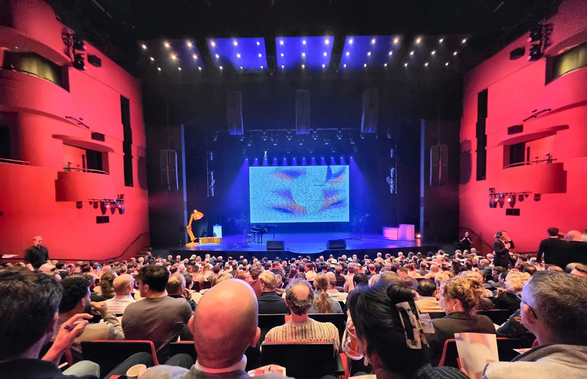
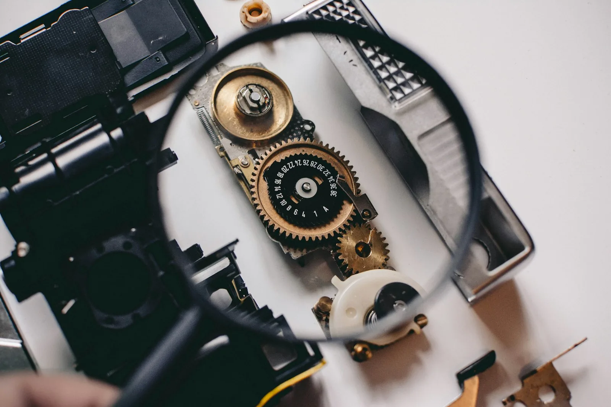

*Photo: [Howard Walsh on Unsplash](https://unsplash.com/photos/sunrise-over-a-misty-road-with-silhouetted-trees-LInAe_7b1HA)*

If more of our work starts as a described outcome that an agent turns into actions, then more of testing becomes checking what came back. That is my own reading, not something anyone presented, and this post works through it, starting from The Collective 2026, Sopra Steria's company event at AFAS Theater in Leusden on 11 November 2026.

My day started earlier. From 10:30, before the main programme began in the afternoon, I was one of the facilitators of a workshop, guiding participants through it.

## Working back from 2030

The last session, Human & Tech: Agentic Development: Teams Reimagined, began in 2030 and worked its way back to the present. Some 200 Dutch colleagues took part, and the question running through it was how we, our roles and our teams will change. The session put it in plain terms: which new skills will you need, what will your team look like, and will you still have a job? Its answer was that the biggest change will be in us, as people reinventing ourselves, more than in the technology.

Starting from the end point made the change feel a lot less abstract to me.

Part of it was a possible picture of 2030. That is an assumption, not a forecast. Given the current pace, though, I do not think it is far off.

What I appreciated most was the message that AI makes our work easier. That is how I look at it too.

## A new interface layer

The way I think about it, AI adds a new interface layer between people and technology. We have spent years building complex systems, tools and APIs. With an agent in between, you can steer, extend and maintain them in plain language. You state the intended outcome, and the agent works out the concrete actions.

Gartner expects agents to take on more of the work, with a clear note of caution. [It predicts](https://www.gartner.com/en/newsroom/press-releases/2025-06-25-gartner-predicts-over-40-percent-of-agentic-ai-projects-will-be-canceled-by-end-of-2027) that by 2028 at least 15% of day-to-day work decisions will be made autonomously through agentic AI, up from 0% in 2024. In the same release it expects over 40% of agentic AI projects to be cancelled by the end of 2027, because of escalating costs, unclear business value or inadequate risk controls. It also warns about "agent washing": existing assistants, RPA tools and chatbots rebranded as agents without real agentic capabilities. For a tester, that is a useful reminder that an agent label is no evidence of what a tool can do.

So the direction is there, but an agent that acts on your behalf still has to earn its place.

## Skills for 2030

At the end of the session, each participant filled in a 2030 passport. Agility and critical thinking appeared on nearly every one. I share that view. Tools will keep changing, so what matters most is the ability to adapt and to question what is in front of you.

That roughly matches wider research, which uses slightly different terms. The World Economic Forum's [Future of Jobs Report 2025](https://www.weforum.org/publications/the-future-of-jobs-report-2025/digest/), based on more than 1,000 employers, names analytical thinking the most sought-after core skill, essential for seven out of ten companies. Resilience, flexibility and agility come next. The same report expects two-fifths (39%) of workers' existing skill sets to be transformed or become outdated between 2025 and 2030.

I expect roles, skills, tools and responsibilities across the SDLC to shift considerably, and teams that start adjusting now to be better placed later.

## What agentic AI means for testing

*Photo: [Shane Aldendorff on Unsplash](https://unsplash.com/photos/person-using-magnifying-glass-to-see-gold-and-white-device-gear-mQHEgroKw2k)*

If you can describe the outcome and let an agent work out the actions, the question for a tester shifts towards whether what came back is right.

Developers seem to land in the same place. In the [Stack Overflow Developer Survey 2026](https://survey.stackoverflow.co/2026/ai), 48% of respondents say they trust AI when they can easily validate its answers, while only 16% extend that trust to most tasks that are not important work decisions. The [survey announcement](https://stackoverflow.blog/2026/10/06/the-results-of-the-2026-developer-survey-are-here/) adds that 93% say trusting what AI gives them requires source attribution. To me, that reads as trust following the ability to check the answer and see where it came from.

DORA, a research programme run by Google Cloud, makes a related point. Its [State of AI-assisted Software Development 2025](https://dora.dev/research/2025/dora-report/) report describes AI's primary role as an amplifier of an organisation's existing strengths and weaknesses. My reading for testing: a team with weak review and test practices will likely see those weaknesses grow with AI.

In my own testing work I am bringing agentic AI in more and more. I already see where it can help: as a sparring partner when shaping a test strategy, for identifying edge cases, and for generating tests. For now these are possibilities I see, not a settled way of working, and what I write here comes from one event and early use rather than measured results.

Every step gets my own review and validation, within clear guardrails. A generated test only becomes useful once you know it is correct. Quality remains our responsibility, even when an agent wrote the test.
