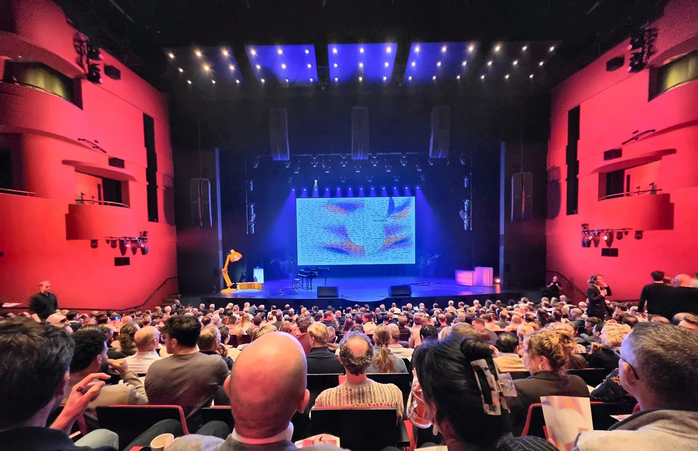
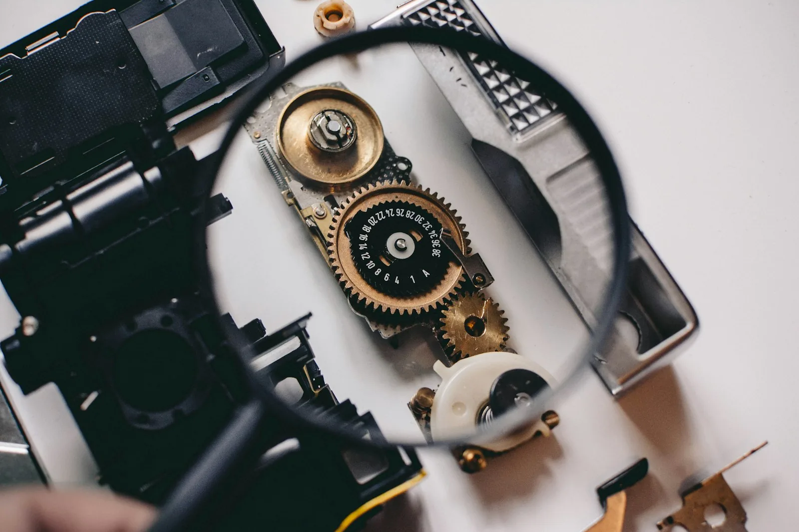

*Foto: [Howard Walsh op Unsplash](https://unsplash.com/photos/sunrise-over-a-misty-road-with-silhouetted-trees-LInAe_7b1HA)*

Als steeds meer van ons werk begint met een beschreven uitkomst die een agent omzet in acties, dan bestaat testen ook steeds meer uit controleren wat er terugkomt. Dat is mijn eigen interpretatie, niet iets wat iemand presenteerde. In dit stuk werk ik die gedachte uit, met als vertrekpunt The Collective 2026, het bedrijfsevent van Sopra Steria in AFAS Theater in Leusden op 11 november 2026.

Mijn dag begon eerder. Vanaf 10:30, voordat het hoofdprogramma ’s middags begon, was ik een van de facilitators van een workshop en begeleidde ik de deelnemers erdoorheen.

## Terugredeneren vanuit 2030

De laatste sessie, Human & Tech: Agentic Development: Teams Reimagined, begon in 2030 en redeneerde terug naar vandaag. Zo’n 200 Nederlandse collega’s deden mee, en de vraag die erdoorheen liep was hoe wij, onze rollen en onze teams gaan veranderen. De sessie stelde het helder: welke nieuwe vaardigheden heb je nodig, hoe ziet je team eruit, en heb je straks nog een baan? De host vatte het achteraf samen als: de grootste verandering ligt meer bij ons, als mensen die zichzelf opnieuw uitvinden, dan bij de technologie.

Vanuit het eindpunt beginnen maakte de verandering voor mij een stuk minder abstract.

Een deel van de sessie schetste een mogelijk beeld van 2030. Dat blijft een aanname. Maar als ik zie hoe snel alles nu gaat, lijkt het me niet eens zo ver weg.

Wat ik het mooiste vond, was de boodschap dat AI ons werk juist makkelijker maakt. Zo kijk ik er zelf ook naar.

## Een nieuwe interfacelaag

Voor mij is AI eigenlijk een nieuwe interfacelaag tussen mens en technologie. We hebben jarenlang complexe systemen, tools en API’s gebouwd. Met een agent ertussen kun je die in gewone taal aansturen, uitbreiden en onderhouden. Je beschrijft wat je wilt bereiken, en de agent zet dat om in concrete acties.

Gartner verwacht dat agents meer van het werk overnemen, met een duidelijke kanttekening. [Gartner voorspelt](https://www.gartner.com/en/newsroom/press-releases/2025-06-25-gartner-predicts-over-40-percent-of-agentic-ai-projects-will-be-canceled-by-end-of-2027) dat tegen 2028 minstens 15% van de dagelijkse werkbeslissingen autonoom wordt genomen via agentic AI, tegen 0% in 2024. In hetzelfde persbericht verwacht Gartner dat meer dan 40% van de agentic-AI-projecten uiterlijk eind 2027 is stopgezet, door stijgende kosten, onduidelijke bedrijfswaarde of onvoldoende risicobeheersing. Het waarschuwt ook voor “agent washing”: bestaande assistenten, RPA-tools en chatbots die als agent worden gepresenteerd zonder wezenlijke agentic mogelijkheden. Voor een tester is dat een nuttige herinnering dat het label “agent” niets bewijst over wat een tool kan.

De richting is er dus, maar een agent die namens jou handelt, moet zijn plek nog verdienen.

## Vaardigheden voor 2030

Aan het eind van de sessie vulde elke deelnemer een paspoort voor 2030 in. Wendbaarheid en kritisch denken stonden op bijna elk paspoort. Dat zie ik ook zo. Tools blijven veranderen, dus wat het meest telt, is het vermogen om je aan te passen en kritisch te kijken naar wat er voor je ligt.

Dat sluit grofweg aan bij breder onderzoek, al gebruikt dat iets andere termen. Het [Future of Jobs Report 2025](https://www.weforum.org/publications/the-future-of-jobs-report-2025/digest/) van het World Economic Forum, gebaseerd op meer dan 1.000 werkgevers, noemt analytisch denken de meest gezochte kernvaardigheid: zeven op de tien bedrijven vinden het essentieel. Daarna volgen veerkracht, flexibiliteit en wendbaarheid. Hetzelfde rapport verwacht dat twee vijfde (39%) van de bestaande vaardigheden van werknemers tussen 2025 en 2030 verandert of verouderd raakt.

Ik denk dat rollen, vaardigheden, tools en verantwoordelijkheden binnen de SDLC flink gaan veranderen, en dat teams die zich daar nu al op aanpassen straks een voorsprong hebben.

## Wat agentic AI betekent voor testen

*Foto: [Shane Aldendorff op Unsplash](https://unsplash.com/photos/person-using-magnifying-glass-to-see-gold-and-white-device-gear-mQHEgroKw2k)*

Als je de uitkomst kunt beschrijven en een agent de acties laat uitwerken, verschuift de vraag voor een tester naar: klopt wat er terugkomt?

Ontwikkelaars lijken op hetzelfde punt uit te komen. In de [Stack Overflow Developer Survey 2026](https://survey.stackoverflow.co/2026/ai) zegt 48% van de respondenten AI te vertrouwen als ze de antwoorden makkelijk kunnen controleren, terwijl maar 16% dat vertrouwen uitbreidt naar de meeste taken die geen belangrijke werkbeslissingen zijn. De [aankondiging van de survey](https://stackoverflow.blog/2026/10/06/the-results-of-the-2026-developer-survey-are-here/) meldt dat 93% bronvermelding nodig vindt om te vertrouwen wat AI geeft. Voor mij betekent dat: vertrouwen volgt de mogelijkheid om het antwoord te controleren en te zien waar het vandaan komt.

DORA, een onderzoeksprogramma van Google Cloud, maakt een vergelijkbaar punt. Het rapport [State of AI-assisted Software Development 2025](https://dora.dev/research/2025/dora-report/) beschrijft de belangrijkste rol van AI als versterker van de bestaande sterke en zwakke punten van een organisatie. Mijn interpretatie voor testen: een team met zwakke review- en testpraktijken ziet die zwaktes met AI waarschijnlijk groter worden.

In mijn eigen testwerk probeer ik agentic AI steeds meer mee te nemen. Ik zie nu al waar het kan helpen: als sparringpartner bij het opzetten van een teststrategie, bij het vinden van edge cases en bij het genereren van tests. Voor nu zijn dit mogelijkheden die ik zie, geen vaste werkwijze, en wat ik hier schrijf komt uit één event en vroeg gebruik, niet uit gemeten resultaten.

Ik review en valideer elke stap zelf, met duidelijke guardrails. Een gegenereerde test is pas waardevol als je zeker weet dat hij klopt. Kwaliteit blijft uiteindelijk onze verantwoordelijkheid, ook als een agent de test schreef.
