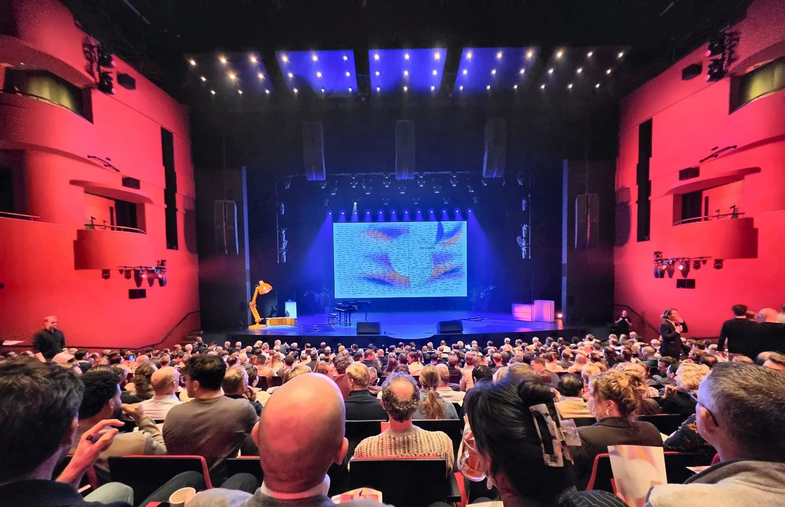
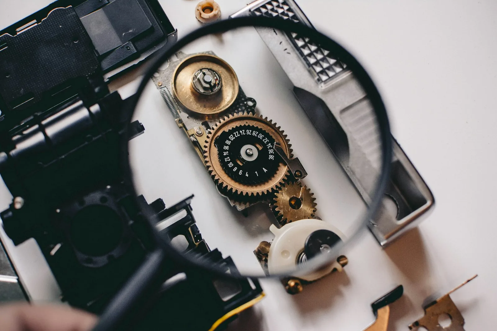

*Fotoğraf: [Howard Walsh, Unsplash](https://unsplash.com/photos/sunrise-over-a-misty-road-with-silhouetted-trees-LInAe_7b1HA)*

İşimizin giderek daha büyük bir kısmı, bir agent’ın eylemlere dönüştürdüğü tarif edilmiş bir sonuçla başlıyorsa, testin de giderek daha büyük bir kısmı geri gelen şeyi kontrol etmek olur. Bu benim kendi yorumum, kimsenin sunduğu bir şey değil. Bu yazıda bu fikri, 11 Kasım 2026’da Leusden’deki AFAS Theater’da düzenlenen Sopra Steria şirket etkinliği The Collective 2026’dan yola çıkarak ele alıyorum.

Günüm daha erken başladı. Öğleden sonra başlayan ana programdan önce, saat 10:30’dan itibaren bir workshop’un facilitator’larından biriydim ve katılımcılara workshop boyunca rehberlik ettim.

## 2030’dan geriye doğru düşünmek

Son oturum, Human & Tech: Agentic Development: Teams Reimagined, 2030’da başladı ve oradan bugüne doğru geri geldi. Yaklaşık 200 Hollandalı meslektaşımız katıldı ve oturumun ana sorusu bizim, rollerimizin ve ekiplerimizin nasıl değişeceğiydi. Oturum bunu açıkça sordu: Hangi yeni becerilere ihtiyacın olacak, ekibin nasıl görünecek ve hâlâ bir işin olacak mı? Oturumun host’u bunu sonradan şöyle özetledi: en büyük değişim teknolojiden çok bizde, kendimizi yeniden keşfeden insanlarda olacak.

Bitiş noktasından başlamak, değişimi benim için çok daha az soyut hâle getirdi.

Oturumun bir bölümü 2030’un olası bir resmini çizdi. Bu bir varsayım. Yine de bugünkü hıza bakınca bunun çok uzak olduğunu düşünmüyorum.

En çok değer verdiğim şey, yapay zekânın işimizi kolaylaştırdığı mesajıydı. Ben de buna böyle bakıyorum.

## Yeni bir arayüz katmanı

Bana göre yapay zekâ, insanlarla teknoloji arasına yeni bir arayüz katmanı ekliyor. Yıllardır karmaşık sistemler, araçlar ve API’ler geliştiriyoruz. Araya bir agent girdiğinde bunları gündelik dille yönlendirebilir, genişletebilir ve bakımını yapabilirsin. İstediğin sonucu tarif edersin, somut eylemleri agent belirler.

Gartner, agent’ların işin daha büyük bir kısmını üstleneceğini bekliyor, ama açık bir uyarıyla. [Öngörüsüne göre](https://www.gartner.com/en/newsroom/press-releases/2025-06-25-gartner-predicts-over-40-percent-of-agentic-ai-projects-will-be-canceled-by-end-of-2027) 2028’e kadar günlük iş kararlarının en az %15’i agentic AI aracılığıyla otonom olarak verilecek; 2024’te bu oran %0’dı. Aynı açıklamada, artan maliyetler, belirsiz iş değeri veya yetersiz risk kontrolleri nedeniyle agentic AI projelerinin %40’ından fazlasının 2027 sonuna kadar iptal edilmesini bekliyor. Ayrıca “agent washing” konusunda uyarıyor: kayda değer agentic yetenekleri olmadan agent diye yeniden paketlenen mevcut asistanlar, RPA araçları ve chatbot’lar. Bir testçi için bu, “agent” etiketinin bir aracın neler yapabildiğine dair kanıt olmadığına dair faydalı bir hatırlatma.

Yani yön belli, ama senin adına iş yapan bir agent’ın yerini hâlâ hak etmesi gerekiyor.

## 2030 için beceriler

Oturumun sonunda her katılımcı bir 2030 pasaportu doldurdu. Çeviklik ve eleştirel düşünme neredeyse hepsinde yer aldı. Ben de aynı görüşteyim. Araçlar değişmeye devam edecek; bu yüzden en önemlisi uyum sağlayabilmek ve önündeki şeyi sorgulayabilmek.

Bu, biraz farklı terimler kullansa da daha geniş araştırmalarla kabaca örtüşüyor. Dünya Ekonomik Forumu’nun 1.000’den fazla işverene dayanan [Future of Jobs Report 2025](https://www.weforum.org/publications/the-future-of-jobs-report-2025/digest/) raporu, analitik düşünmeyi en çok aranan temel beceri olarak gösteriyor; şirketlerin onda yedisi bunu vazgeçilmez buluyor. Ardından dayanıklılık, esneklik ve çeviklik geliyor. Aynı rapor, çalışanların mevcut beceri setlerinin beşte ikisinin (%39) 2025 ile 2030 arasında dönüşmesini ya da eskimesini bekliyor.

SDLC boyunca rollerin, becerilerin, araçların ve sorumlulukların ciddi biçimde değişeceğini, şimdiden uyum sağlamaya başlayan ekiplerin de ileride daha iyi konumda olacağını düşünüyorum.

## Agentic AI test için ne anlama geliyor

*Fotoğraf: [Shane Aldendorff, Unsplash](https://unsplash.com/photos/person-using-magnifying-glass-to-see-gold-and-white-device-gear-mQHEgroKw2k)*

Sonucu tarif edip eylemleri bir agent’a bırakabiliyorsan, testçinin sorusu da geri gelen şeyin doğru olup olmadığına kayıyor.

Geliştiriciler de benzer bir noktaya varıyor gibi görünüyor. [Stack Overflow Developer Survey 2026](https://survey.stackoverflow.co/2026/ai)’da katılımcıların %48’i, yapay zekânın cevaplarını kolayca doğrulayabildiklerinde yapay zekâya güvendiklerini söylüyor; bu güveni önemli iş kararı olmayan çoğu göreve genişletenler ise yalnızca %16. [Anket duyurusu](https://stackoverflow.blog/2026/10/06/the-results-of-the-2026-developer-survey-are-here/) da %93’ün, yapay zekânın verdiğine güvenmek için kaynak gösterilmesini gerekli gördüğünü bildiriyor. Bana göre bu, güvenin, cevabı kontrol edebilmeye ve nereden geldiğini görebilmeye bağlı olduğu anlamına geliyor.

Google Cloud’un yürüttüğü bir araştırma programı olan DORA da benzer bir noktaya değiniyor. [State of AI-assisted Software Development 2025](https://dora.dev/research/2025/dora-report/) raporu, yapay zekânın temel rolünü bir organizasyonun mevcut güçlü ve zayıf yönlerini büyüten bir güçlendirici olarak tanımlıyor. Test açısından benim yorumum: review ve test pratikleri zayıf bir ekip, yapay zekâyla bu zayıflıkların büyüdüğünü muhtemelen görecek.

Kendi test işimde agentic AI’ı giderek daha fazla işin içine katmaya çalışıyorum. Nerede yardımcı olabileceğini şimdiden görüyorum: test stratejisi oluştururken bir sparring partner olarak, edge case’leri belirlemede ve test üretmede. Şimdilik bunlar gördüğüm olasılıklar, oturmuş bir çalışma biçimi değil; burada yazdıklarım da ölçülmüş sonuçlardan değil, tek bir etkinlikten ve erken kullanımdan geliyor.

Her adımı net guardrail’ler içinde kendim review ediyor ve doğruluyorum. Üretilmiş bir test, ancak doğru olduğunu bildiğinde işe yarar. Testi bir agent yazmış olsa bile kalite bizim sorumluluğumuzda kalıyor.
