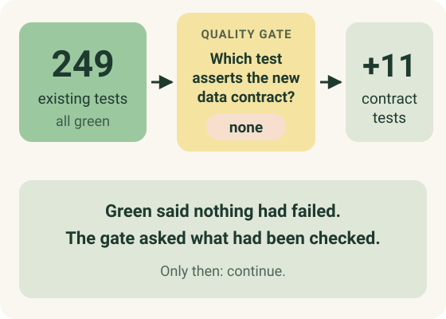
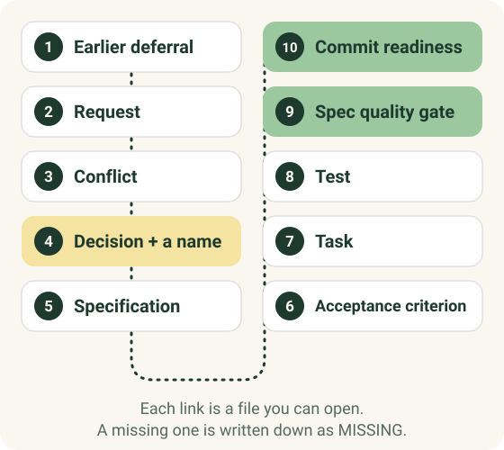

There is a moment every tester knows. The pipeline turns green, someone leans back and says "done", and you feel the small itch of a question nobody has asked yet.

In September I felt that itch in an unusual place: inside an AI tool that refused to let me move on.

## The setting

Sopra Steria ran a hands-on workshop for AI Backbone in Nieuwegein: a platform that does not let AI agents write code freely, but walks them through fixed workflows with stations, quality gates and a human decision at each step. The version I used had 33 agents, 174 skills and 22 workflows.

We worked in mixed teams: product owner, business analyst, architect, developer, tester. Together we scoped one small feature for an existing app, offering a freed seat in a training session to the next person on the waitlist. On the day we got as far as the specification. I wanted to see how the chain holds up all the way to a commit, so I finished the rest at home.

That second part is where this post comes from.

## Green, and still not done

The agent wrote the code for the first task. I ran the suite myself, the way the workshop told us to, and compared it with the baseline: 33 files, 249 tests, all green before the change, all green after.

Most AI coding tools would stop here and report success. To be fair, many human teams would too.

The test-generation gate did not. It noticed that the new code introduced a data contract (what the waitlist hands over when a seat is offered) and that **not one of the 249 tests asserted anything about it**. The suite was green because nothing in it was looking. The gate asked for 11 new contract tests before I could continue.

> A green suite says the assertions we wrote did not fail. It says nothing about the assertions we never wrote.

None of this is new to anyone in testing. Martin Fowler wrote about [contract tests](https://martinfowler.com/bliki/ContractTest.html) years ago, and "coverage is not correctness" has been on conference slides for as long as I have worked in QA. What surprised me was seeing it enforced by the tool, at the exact moment when a hurried person would say "ship it".

## The test that tried to wipe my data

The second gate is less dramatic and, to me, even more convincing.

One of the generated tests reset the database to get a clean state. That is a sensible idea in a disposable environment. On my machine it would have wiped the working database I was developing against.

The commit-readiness gate blocked it. The test only passed review once it ran against temporary fixtures. Nobody had to spot it in a code review; the rule was already in the path.

As a tester, that is the kind of check I care about most: not the clever one, but the boring one that stops a well-meant action from doing damage.

## Why the human still matters

It would be easy to turn this into "the AI caught what humans miss". That is not what I saw.

The workshop was built around three words: **Continue, Correct, Stop**. At each station the agent pauses and a person decides.

The feature request we started from contained requirements that could not all be true at once, and the most important moment of the day was not a gate at all. The project rules still said this feature had been consciously deferred, and the AI was ready to carry on regardless. We chose Correct: the rule was changed, with a name and a reason next to it.

That is the part I keep coming back to. The tool can notice that a contract is untested. It cannot decide which of two reasonable business rules wins, or who is allowed to undo an earlier decision. When it tries, the right answer is to stop it, and that only works if someone is actually reading.

There is research behind this unease. Parasuraman and Manzey's [review of automation complacency and bias](https://pubmed.ncbi.nlm.nih.gov/21077562/) found that people over-trust automated aids even when they are experts, and that training alone does not fix it. A process that makes you open the file and choose, every time, is one of the few countermeasures I know of.

## A chain you can walk back

At the end we walked the trace out loud, one link per person: the earlier deferral, the request, the conflict, the decision and who made it, the specification, the acceptance criterion, the task, the test, the spec quality gate and commit readiness. Ten links, and each one is a file you can open.

It sounds bureaucratic, and honestly, sometimes it felt that way. For one small first change, the platform produced a lot of documentation, and not all of it was a pleasure to read. Quick hacks are not possible; every station is mandatory. But I have also sat in audits where nobody could explain why a rule existed. Months later, this chain would answer that question in minutes.

## What I take from it

The [2024 DORA report](https://cloud.google.com/blog/products/devops-sre/announcing-the-2024-dora-report) found that, as AI adoption went up, delivery stability went down, by an estimated 7.2%. Correlation, not proof, but it matches my instinct: generating code faster is the easy part, and knowing whether it is safe to ship is the hard part.

So my takeaway is modest:

- **Treat "all tests pass" as a question.** Which tests, asserting what, about which change?
- **Put the boring guards in the path, not in a checklist.** A blocked test that wipes data is worth more than a review comment that might be missed.
- **Let the AI propose and let people decide.** And write down whose decision it was, by name.

AI Backbone is not a magic tool that takes over your job tomorrow. It is a rough diamond: slow at first, demanding, and in places still unfinished. But it is one of the few approaches I have seen that uses AI seriously without losing the grip on quality. I build something similar on a much smaller scale in [devran-ai/kit](https://github.com/devran-ai/kit), quality gates and all, so I may be biased. I would rather be biased towards gates than towards green.
