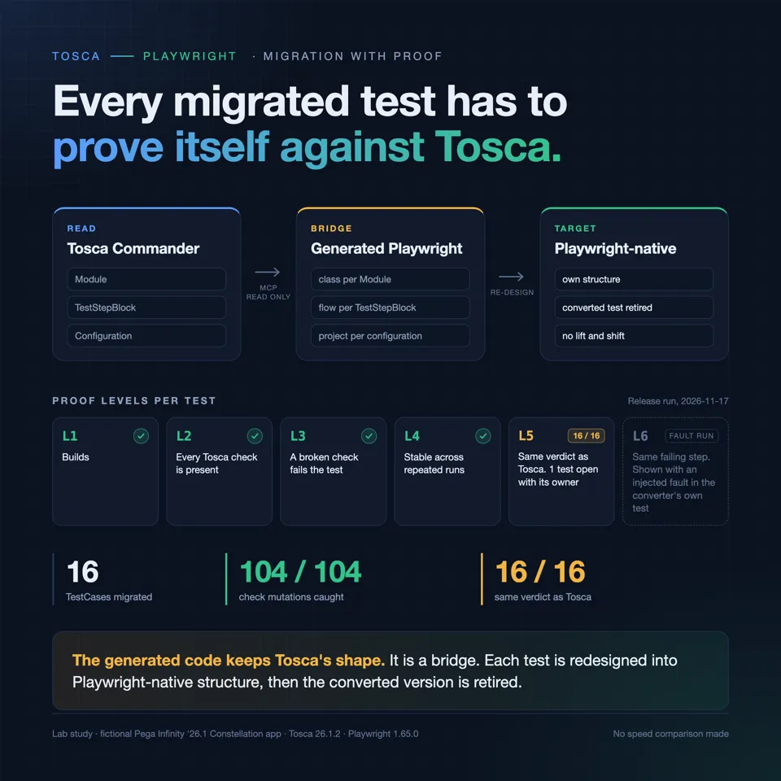

When a team has decided to move a test suite from Tricentis Tosca to Playwright, the part I scrutinise most is knowing that each converted test still catches what the original caught. The decision itself, whether to migrate at all, is in [a companion post](/blog/tosca-or-playwright-before-you-migrate).

My examples come from a lab I built for this purpose: a fictional personal loan request application (PLR) that I built from a Pega Blueprint in a Pega Academy lab environment, on Pega Infinity '26.1 Constellation, tested with Tosca 26.1.2 (the [2026.1 LTS](https://docs.tricentis.com/tosca-2026.1/en-us/content/release_notes/key_features.htm) release line) and migrated to Playwright 1.65.0.

## A passing test proves little

A migrated test that passes proves little: a test that asserts nothing passes too. Generated code has the same risk. The Playwright documentation itself says generated tests "may include initial errors", and that the healer agent can return "a skipped test if the healer believes that functionality is broken" ([Playwright test agents](https://playwright.dev/docs/test-agents), read 2026-11-17). On a summary view, a skip can be read as a pass.

## Classify before you convert

I would not migrate a suite one to one. Before anything is generated I classify every TestCase (Tosca's unit of a test): move, keep in Tosca, retire (proposed to the test owner), or exclude (sandbox and template TestCases, for example).

I also look for what I call level debt: business rules checked through the UI that belong in an API or unit test. "Due to their high maintenance cost you should aim to reduce the number of end-to-end tests to a bare minimum," as Ham Vocke wrote in [The Practical Test Pyramid](https://martinfowler.com/articles/practical-test-pyramid.html) (2018). A migration is a good moment to pay that debt, because every test is being touched anyway.

Coverage decisions follow risk. The flows that carry money, data or regulatory weight move first and get the strictest proof.

## Convert to a bridge, then redesign

I could not find an official converter from Tricentis Tosca to Playwright, so I wrote one as a Claude Code plugin. It reads Tosca Commander through the Tosca MCP Server in read-only mode and generates a Playwright Test project in TypeScript.

The generated code keeps Tosca's shape on purpose: one class per Module, one flow per TestStepBlock, one Playwright project per Tosca configuration. That makes it a good bridge and a poor framework. It keeps every check comparable with its Tosca original, so it can be proven against the Tosca verdict. Afterwards each test is redesigned into Playwright-native structure, and the converted version is retired. A migration that stops at conversion is a lift and shift: new runtime, old design.

## The method in five steps

1. Inventory: read the whole Tosca workspace, not a subset. Tosca's own subset export leaves out anything defined on the project root element (the top node of the Tosca project), including project-level test configuration parameters ([Tosca 2026.1 docs, subsets](https://docs.tricentis.com/tosca-2026.1/en-us/content/tosca_commander/import_export_subsets.htm)). A converter that misses them misses environment data.
2. Analysis: map user flows, decide per TestCase as above, name the level debt and agree the target architecture with the team before any code exists.
3. Shared layer first, in the Playwright-native redesign: screens, flows, data and sign-in, then the tests. Otherwise every test gets its own helpers. The generated bridge mirrors Tosca; the shared layer belongs to the redesign.
4. Proof per test, on six levels (next section). A test counts as migrated only when its proof is recorded against the code it ran on.
5. Parallel run and retirement: run both suites on the same builds, compare verdicts per test, and retire Tosca TestCases slice by slice. An all-at-once cutover would remove the comparison that makes the proof possible.

## Six levels of proof

| Level | What it proves |
|---|---|
| L1 | The test builds: types, lint, listed by the runner |
| L2 | Every check from the Tosca TestCase is present |
| L3 | Every check is mutated once, and the test fails at that check |
| L4 | The test is stable over repeated runs |
| L5 | Same verdict as Tosca on the same build |
| L6 | When both fail, they fail at the same step |

L3 borrows from mutation testing, which Google runs at scale in code review ([Petrovic and Ivankovic, State of Mutation Testing at Google](https://research.google/pubs/state-of-mutation-testing-at-google/)). L5 and L6 borrow from parallel running in legacy replacement, which is used to check that "key numbers match up" between old and new ([Cartwright, Horn and Lewis, Patterns of Legacy Displacement, 2022](https://martinfowler.com/articles/patterns-legacy-displacement/divert-the-flow.html)).

## What the lab showed

In the latest run, on 2026-11-17, 20 TestCases were in scope. One was covered by the shared sign-in and environment check, one was a template definition and one a sandbox TestCase, so 17 were migrated. The figures below are for these migrated Playwright tests, each testing exactly the same business requirements as its Tosca original. The run used two target architectures, a layered one and a BDD one on playwright-bdd, and all 105 mutants of the checks were killed in both. The numbers differ from [my earlier LinkedIn post](https://www.linkedin.com/posts/emre-dursun-nl_tosca-playwright-testautomation-activity-7528389765512171525-Ajmi) because the latest run added the invalid-password TestCase described below. That earlier run had 16 TestCases and 104 mutants.

One test timed out once in its repeated stability runs; repeated again, it passed three times out of three. That run stays in its stability history rather than being written off. L6 needs a failure on both sides. The earlier run could not show it, because nothing failed in Tosca, so the latest run checked L6 with a deliberately injected fault.

16 of the 17 migrated tests gave the same verdict as Tosca on the same build. The 17th is the instructive one. Its name says it tests a login with an invalid password. Its check, however, expects the sign-in to be accepted. In Tosca the step enters a wrong password, Pega rejects the sign-in, so the TestCase fails at its own check. The migrated test signs in with the test account's password and passes. The two verdicts differ, and because the check and the name contradict each other, the case went to the test owner.

A migration can turn a test's intent around without anyone noticing. In the lab, the per-test comparison is what made it visible.

The scope was one application, one lab and Chromium only, with no speed comparison against Tosca.

## Automation and the long tail

Automation helps with volume. Airbnb reported migrating 75% of its target test files in four hours with an LLM pipeline, and 97% after four days of tuning. The remaining files took about another week by hand, and the whole migration took six weeks of engineering time against a 1.5-year manual estimate ([Airbnb Tech Blog, Accelerating Large-Scale Test Migration with LLMs](https://airbnb.tech/?p=366)). The lesson is the long tail: plan human time for the last few percent, and do not count a test as done because a tool produced it.

## Proof checklist

- [ ] Every TestCase has a decision: move, keep, retire (agreed with its owner) or exclude.
- [ ] The full workspace is in the inventory, including root-level parameters.
- [ ] Each migrated test has recorded proof: builds, every check present, mutated and killed, stable, same verdict as Tosca.
- [ ] Differences in verdict go to a named test owner.
- [ ] Tosca TestCases are retired slice by slice, after parity.

## Sources

All read on 2026-11-17 unless a publication date is given.

- Playwright test agents (planner, generator, healer): https://playwright.dev/docs/test-agents
- Tosca 2026.1 LTS key features (release line): https://docs.tricentis.com/tosca-2026.1/en-us/content/release_notes/key_features.htm
- Tosca 2026.1, import and export subsets: https://docs.tricentis.com/tosca-2026.1/en-us/content/tosca_commander/import_export_subsets.htm
- Ham Vocke, The Practical Test Pyramid (2018-02-26): https://martinfowler.com/articles/practical-test-pyramid.html
- Ian Cartwright, Rob Horn, James Lewis, Patterns of Legacy Displacement: Divert the Flow (2022-01-20): https://martinfowler.com/articles/patterns-legacy-displacement/divert-the-flow.html
- Goran Petrovic, Marko Ivankovic, State of Mutation Testing at Google (ICSE SEIP 2018): https://research.google/pubs/state-of-mutation-testing-at-google/
- Airbnb Tech Blog, Accelerating Large-Scale Test Migration with LLMs: https://airbnb.tech/?p=366
- My earlier LinkedIn post on the Tosca to Playwright lab (16 TestCases, 104 mutants): https://www.linkedin.com/posts/emre-dursun-nl_tosca-playwright-testautomation-activity-7528389765512171525-Ajmi
