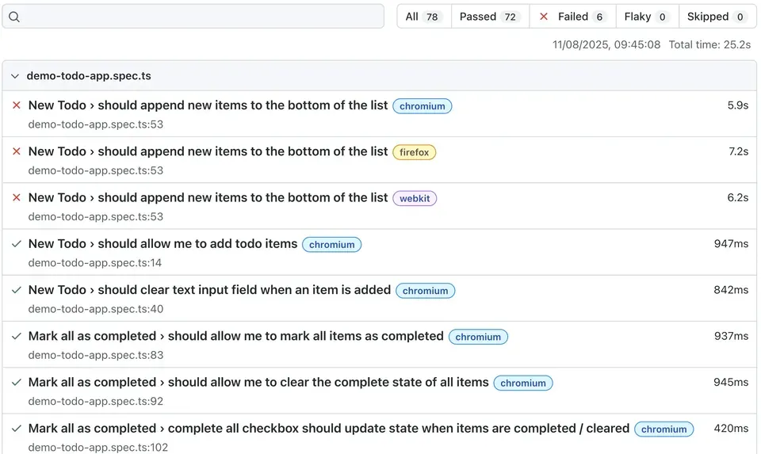
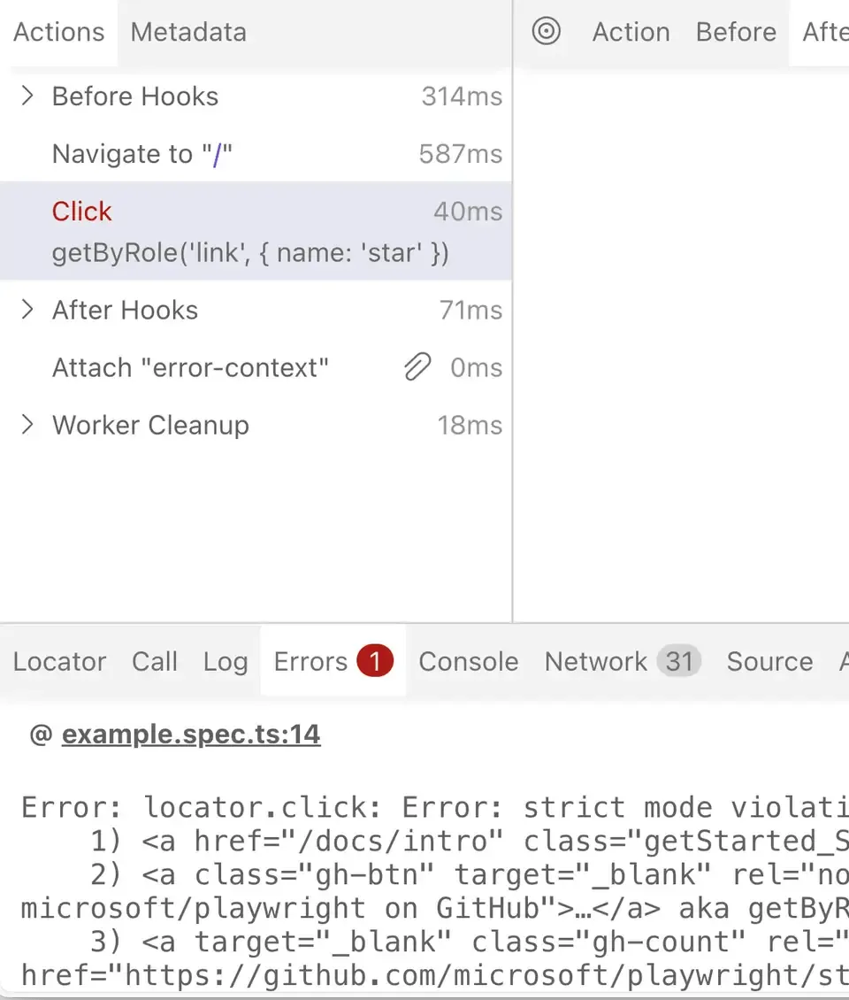

Bir ekip test paketini Tricentis Tosca’dan Playwright’a taşımaya karar verdiğinde en dikkatle baktığım kısım, dönüştürülen her testin orijinalin yakaladığını hâlâ yakaladığını bilmek. Kararın kendisi, yani taşınıp taşınmayacağı, [ilk yazıda](/tr/blog/tosca-or-playwright-before-you-migrate) ele alınıyor.

Örneklerim bu amaçla kurduğum bir labdan geliyor: bir Pega Academy lab ortamında Pega Blueprint ile oluşturduğum kurgusal bir kişisel kredi talebi uygulaması (PLR). Uygulama Pega Infinity '26.1 Constellation üzerinde çalışıyor, Tosca 26.1.2 ile ([2026.1 LTS](https://docs.tricentis.com/tosca-2026.1/en-us/content/release_notes/key_features.htm) sürüm hattı) test edildi ve Playwright 1.65.0’a taşındı.

## Geçen bir test pek az şey kanıtlar

Taşınan bir testin geçmesi pek az şey kanıtlar: hiçbir şeyi doğrulamayan bir test de geçer. Üretilmiş kodda da aynı risk var. Playwright dokümantasyonunun kendisi üretilen testlerin “may include initial errors” olabileceğini ve healer agent’ın, işlevin bozuk olduğuna inanırsa “a skipped test” döndürebileceğini söylüyor ([Playwright test agents](https://playwright.dev/docs/test-agents), 2026-11-17’de okundu). Özet görünümde bir skip, geçmiş gibi okunabilir.

## Dönüştürmeden önce sınıflandır

Bir paketi bire bir taşımazdım. Bir şey üretilmeden önce her TestCase’i (Tosca’da bir testin birimi) sınıflandırırım: taşı, Tosca’da tut, emekli et (test sahibine önerilir) ya da dışarıda bırak (örneğin sandbox ve şablon TestCase’leri).

Ayrıca ben seviye borcu diyeceğim şeye bakarım: arayüz üzerinden kontrol edilen ama bir API ya da unit testine ait iş kuralları. Ham Vocke, [The Practical Test Pyramid](https://martinfowler.com/articles/practical-test-pyramid.html) (2018) yazısında şöyle diyordu: “Due to their high maintenance cost you should aim to reduce the number of end-to-end tests to a bare minimum.” Geçiş bu borcu ödemek için iyi bir an, çünkü zaten her teste dokunuluyor.

Kapsama kararları riski izler. Para, veri ya da düzenleyici ağırlık taşıyan akışlar önce taşınır ve en sıkı kanıtı alır.

## Önce bir köprüye dönüştür, sonra yeniden tasarla

Tricentis Tosca’dan Playwright’a resmi bir dönüştürücü bulamadım, bu yüzden Claude Code eklentisi olarak kendim yazdım. Tosca Commander’ı Tosca MCP Server üzerinden salt okunur kipte okuyor ve TypeScript ile bir Playwright Test projesi üretiyor.

Üretilen kod Tosca’nın biçimini bilerek koruyor: her Module için bir sınıf, her TestStepBlock için bir akış, her Tosca yapılandırması için bir Playwright projesi. Bu onu iyi bir köprü ama zayıf bir framework yapıyor. Her kontrolü Tosca’daki orijinaliyle karşılaştırılabilir tutuyor, böylece Tosca sonucuna karşı kanıtlanabiliyor. Sonrasında her test Playwright’a özgü bir yapıya yeniden tasarlanır ve dönüştürülmüş sürüm emekli edilir. Dönüştürmede duran bir geçiş bir lift and shift’tir: yeni çalışma zamanı, eski tasarım.

## Yöntem, beş adımda

1. Envanter: Tosca workspace’inin tamamını oku, bir alt kümesini değil. Tosca’nın kendi alt küme dışa aktarımı, proje kök öğesinde (Tosca projesinin en üst düğümü) tanımlı her şeyi dışarıda bırakır; proje düzeyindeki test yapılandırma parametreleri de buna dahildir ([Tosca 2026.1 dokümanları, alt kümeler](https://docs.tricentis.com/tosca-2026.1/en-us/content/tosca_commander/import_export_subsets.htm)). Bunları kaçıran bir dönüştürücü ortam verisini kaçırır.
2. Analiz: kullanıcı akışlarını eşle, TestCase başına yukarıdaki gibi karar ver, seviye borcunu adlandır ve henüz kod yokken hedef mimariyi ekiple kabul et.
3. Playwright’a özgü yeniden tasarımda önce paylaşılan katman: ekranlar, akışlar, veri ve oturum açma, sonra testler. Aksi halde her test kendi yardımcılarını edinir. Üretilen köprü Tosca’yı yansıtır; paylaşılan katman yeniden tasarıma aittir.
4. Test başına kanıt, altı seviyede (sonraki bölüm). Bir test, ancak kanıtı çalıştığı kodla birlikte kaydedildiğinde taşınmış sayılır.
5. Paralel çalıştırma ve emeklilik: iki paketi aynı build’lerde çalıştır, sonuçları test başına karşılaştır ve Tosca TestCase’lerini dilim dilim emekli et. Her şeyi bir seferde geçirmek, kanıtı mümkün kılan karşılaştırmayı ortadan kaldırırdı.

*Ekran görüntüsü: Playwright dokümantasyonu, © Microsoft, [Apache License 2.0](https://github.com/microsoft/playwright/blob/main/LICENSE), kırpıldı. Örnek rapor, labdan değil.*

## Altı kanıt seviyesi

| Seviye | Neyi kanıtlar |
|---|---|
| L1 | Test derleniyor: tipler, lint, çalıştırıcı tarafından listeleniyor |
| L2 | Tosca TestCase’indeki her kontrol mevcut |
| L3 | Her kontrol bir kez mutasyona uğratılır ve test o kontrolde başarısız olur |
| L4 | Test tekrarlanan çalıştırmalarda kararlı |
| L5 | Aynı build’de Tosca ile aynı sonuç |
| L6 | İkisi de başarısız olduğunda aynı adımda başarısız olurlar |

L3, Google’ın kod incelemesinde büyük ölçekte kullandığı mutation testing’den ödünç alır ([Petrovic ve Ivankovic, State of Mutation Testing at Google](https://research.google/pubs/state-of-mutation-testing-at-google/)). L5 ve L6 ise eski sistemin değiştirilmesinde kullanılan paralel çalıştırmadan ödünç alır; bu yöntem eski ve yeni arasında “key numbers match up” olduğunu denetlemek için kullanılır ([Cartwright, Horn ve Lewis, Patterns of Legacy Displacement, 2022](https://martinfowler.com/articles/patterns-legacy-displacement/divert-the-flow.html)).

*Ekran görüntüsü: Playwright dokümantasyonu, © Microsoft, [Apache License 2.0](https://github.com/microsoft/playwright/blob/main/LICENSE), kırpıldı. Örnek trace, labdan değil.*

## Lab ne gösterdi

Yayımlanan dönüştürücüyle (1.0.0, 2026-11-17) yapılan çalıştırmada kapsamda 20 TestCase vardı. Biri paylaşılan oturum açma ve ortam kontrolüyle karşılanıyordu, biri şablon tanımıydı, biri de sandbox TestCase’iydi. Kalan 17’nin 16’sı L1–L5 seviyesinde taşındı; her biri Tosca’daki orijinaliyle tamı tamına aynı iş gereksinimlerini test ediyor. Çalıştırmada iki hedef mimari kullanıldı, biri katmanlı, diğeri playwright-bdd üzerinde bir BDD mimarisi. İkisinde de kontrollerin 104 mutantının tamamı kendi kontrolünde öldürüldü, belirsiz kalan mutant olmadı ve taşınan testler aynı build’de Tosca ile aynı sonucu verdi. [LinkedIn gönderimde](https://www.linkedin.com/posts/emre-dursun-nl_tosca-playwright-testautomation-activity-7528389765512171525-Ajmi) de aynı rakamlar var.

Aynı gün yapılan daha önceki bir çalıştırmada bir test, tekrarlanan kararlılık çalıştırmalarında bir kez zaman aşımına uğradı; yeniden tekrarlandığında üç denemenin üçünde geçti. Bu çalıştırma yok sayılmak yerine kararlılık geçmişinde duruyor. L6 için iki tarafta da bir hata gerekir. Taşınan 16 testin hiçbiri Tosca’da başarısız olmadığı için lab bunu gösteremedi; bu yüzden L6, dönüştürücünün kendi uçtan uca testinde bilerek enjekte edilmiş bir hatayla denetleniyor.

17. TestCase öğretici olanı ve hâlâ açık. Adı, geçersiz parolayla bir oturum açmayı test ettiğini söylüyor. Ancak kontrolü oturum açmanın kabul edilmesini bekliyor. Tosca’da adım yanlış bir parola giriyor, Pega oturum açmayı reddediyor ve TestCase kendi kontrolünde başarısız oluyor. O önceki çalıştırmada taşınan test yine de test hesabının parolasını kullanıyor, oturum açıyor ve geçiyordu. İki sonuç farklıydı ve kontrol ile ad birbirine ters düştüğü için vaka test sahibine gitti. Yayımlanan dönüştürücü artık böyle bir teste hesap parolası vermiyor: test, sahibi testin yazacağı yanlış parolayı verene kadar bloke kalıyor.

Bir geçiş, kimse fark etmeden bir testin amacını tersine çevirebilir. Labda bunu görünür kılan, test başına yapılan karşılaştırma oldu.

Kapsam tek bir uygulama, tek bir lab ve yalnızca Chromium’du; Tosca ile hız karşılaştırması yapılmadı.

## Otomasyon ve uzun kuyruk

Otomasyon hacimde yardımcı olur. Airbnb, bir LLM pipeline’ı ile hedef test dosyalarının yüzde 75’ini dört saatte, yüzde 97’sini ise dört günlük ayardan sonra taşıdığını bildirdi. Kalan dosyalar elle yaklaşık bir hafta daha aldı ve geçişin tamamı, 1,5 yıllık manuel tahmine karşılık altı haftalık mühendislik zamanı sürdü ([Airbnb Tech Blog, Accelerating Large-Scale Test Migration with LLMs](https://airbnb.tech/?p=366)). Ders uzun kuyrukta: son birkaç yüzde için insan zamanı planlayın ve bir test bir araç ürettiği için bitmiş sayılmasın.

## Kanıt kontrol listesi

- [ ] Her TestCase için bir karar var: taşı, tut, emekli et (sahibiyle kararlaştırılmış) ya da dışarıda bırak.
- [ ] Tam workspace envanterde, kök düzeyindeki parametreler dahil.
- [ ] Her taşınan testin kayıtlı kanıtı var: derleniyor, her kontrol mevcut, mutasyona uğratılıp öldürülmüş, kararlı, Tosca ile aynı sonuç.
- [ ] Sonuç farkları adı belli bir test sahibine gidiyor.
- [ ] Tosca TestCase’leri, eşitlik sağlandıktan sonra dilim dilim emekli ediliyor.

## Kaynaklar

Başka bir yayın tarihi verilmediyse hepsi 2026-11-17’de okundu.

- Playwright test agents (planner, generator, healer): https://playwright.dev/docs/test-agents
- Tosca 2026.1 LTS temel özellikleri (sürüm hattı): https://docs.tricentis.com/tosca-2026.1/en-us/content/release_notes/key_features.htm
- Tosca 2026.1, alt kümelerin içe ve dışa aktarımı: https://docs.tricentis.com/tosca-2026.1/en-us/content/tosca_commander/import_export_subsets.htm
- Ham Vocke, The Practical Test Pyramid (2018-02-26): https://martinfowler.com/articles/practical-test-pyramid.html
- Ian Cartwright, Rob Horn, James Lewis, Patterns of Legacy Displacement: Divert the Flow (2022-01-20): https://martinfowler.com/articles/patterns-legacy-displacement/divert-the-flow.html
- Goran Petrovic, Marko Ivankovic, State of Mutation Testing at Google (ICSE SEIP 2018): https://research.google/pubs/state-of-mutation-testing-at-google/
- Airbnb Tech Blog, Accelerating Large-Scale Test Migration with LLMs: https://airbnb.tech/?p=366
- Tosca’dan Playwright’a lab hakkındaki LinkedIn gönderim (16 TestCase, 104 mutant): https://www.linkedin.com/posts/emre-dursun-nl_tosca-playwright-testautomation-activity-7528389765512171525-Ajmi
- Playwright dokümantasyonu görselleri, HTML raporu ve Trace Viewer (Apache License 2.0, 2026-11-19’da indirildi): https://github.com/microsoft/playwright/tree/main/docs/src/images/getting-started
