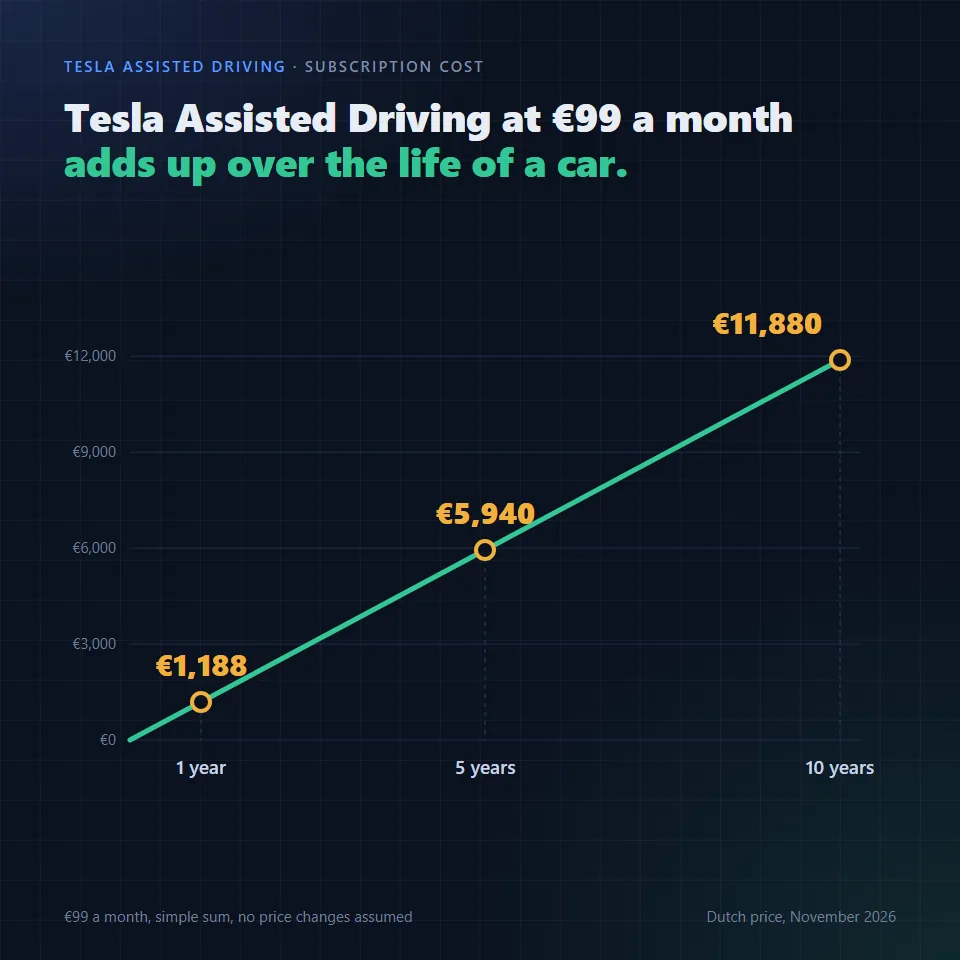
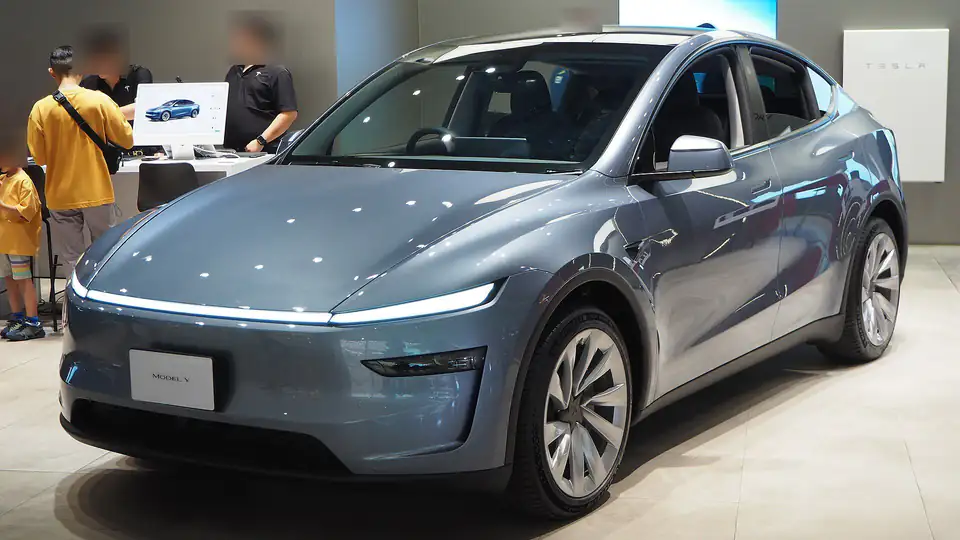
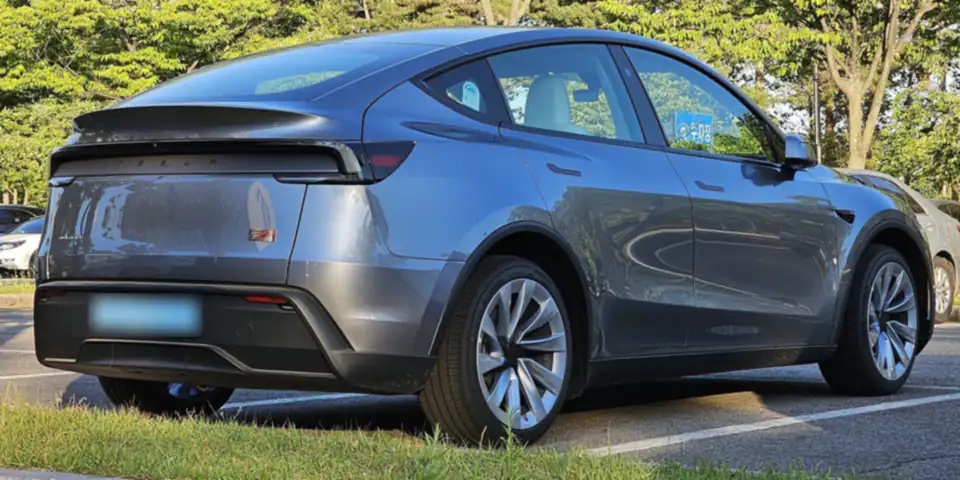
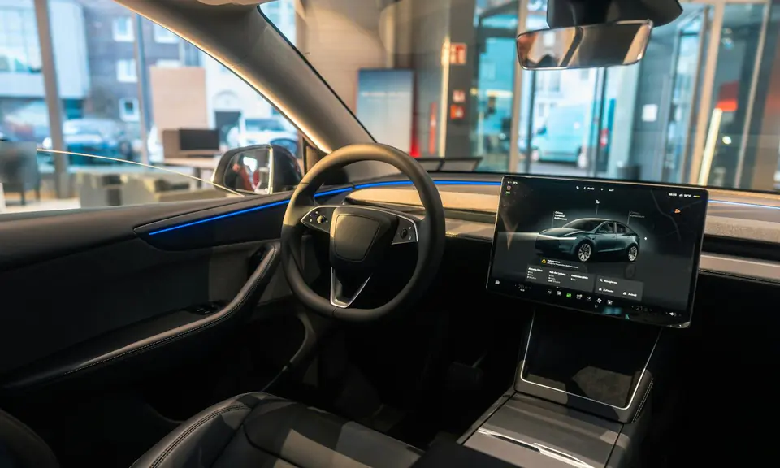
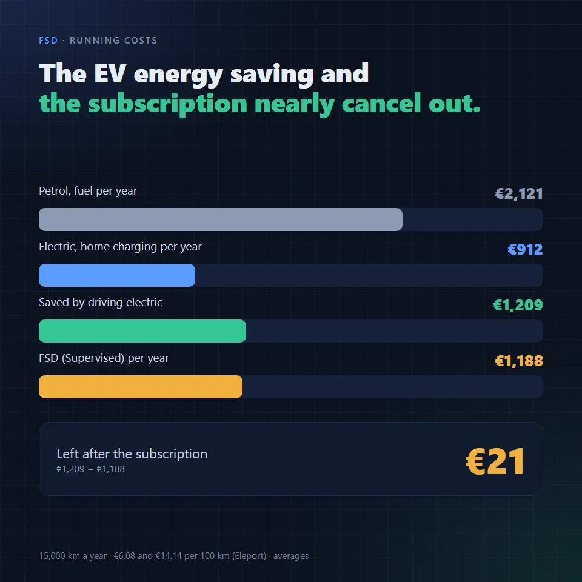
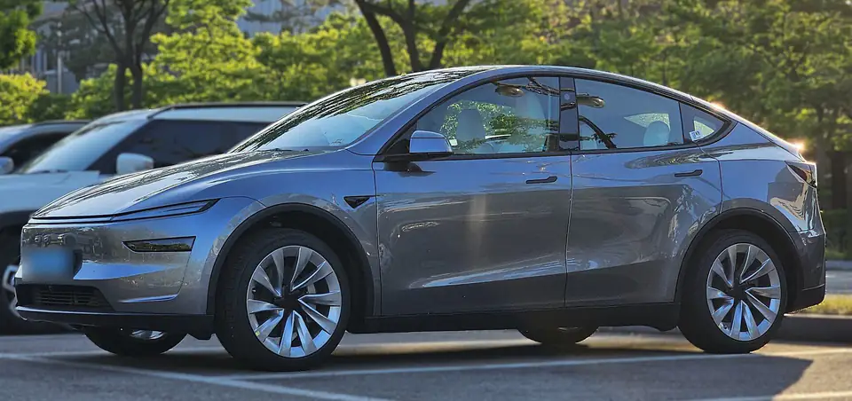
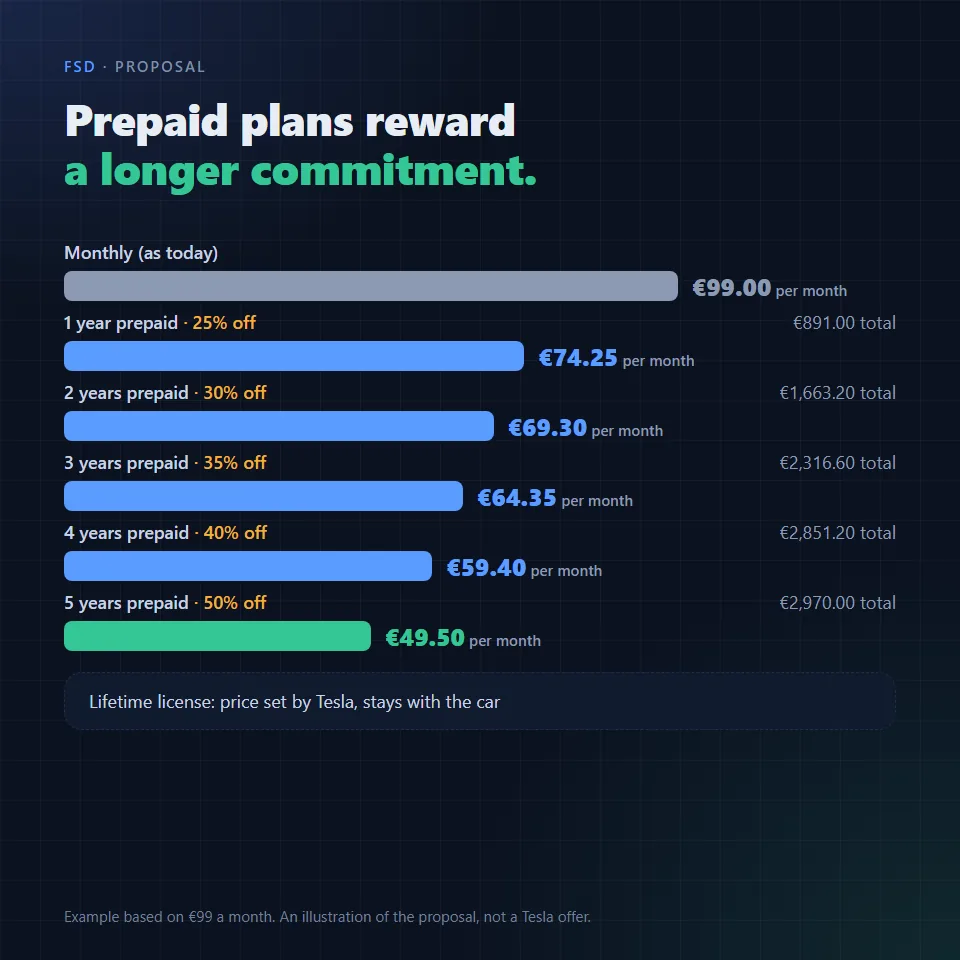

In the Netherlands, Tesla Assisted Driving, the European name for what was sold as FSD (Supervised), costs €99 a month, and new buyers can no longer pay once and own it. I am asking Tesla to offer a one-time purchase and prepaid multi-year plans next to the monthly subscription. This article sets out the facts, the cost over the life of a car and a concrete pricing proposal.

My goal is a constructive conversation with Tesla, not an attack on the brand.

## Why this matters to me

I bought a Tesla Model Y Premium Long Range AWD. Before buying, I took a test drive and compared several electric cars. Compared with the other brands, my experience with Tesla was better, so I chose Tesla. Future Tesla Assisted Driving support mattered to me: I ruled out a used Model S Plaid because its Hardware 3 computer would not support it, and in Europe it is approved for Hardware 4 cars only. The one thing I do not like about Tesla is that Tesla Assisted Driving is subscription-only and, in my view, expensive. That is why the way these features are sold matters to me.

*Tesla Model Y Long Range AWD (2025) in a showroom. Photo: Chanokchon, [CC BY-SA 4.0](https://creativecommons.org/licenses/by-sa/4.0/), via [Wikimedia Commons](https://commons.wikimedia.org/wiki/File:2025_Tesla_Model_Y_Juniper_Long_Range_AWD.jpg). Faces blurred, resized. A display car, not mine.*

*Tesla Model Y Dual Motor (AWD) in Quicksilver (2025). Photo: Damian B Oh, [CC BY-SA 4.0](https://creativecommons.org/licenses/by-sa/4.0/), via [Wikimedia Commons](https://commons.wikimedia.org/wiki/File:Tesla_Model_Y_Dual_Motor_First_Edition_Juniper_Quicksilver_%2816%29.jpg). Licence plate blurred, cropped and resized. Not my car.*

## The facts

These points come from public sources, listed at the end of this article.

- In Europe, Tesla now sells what was FSD (Supervised) as Tesla Assisted Driving ([Tesla Netherlands](https://www.tesla.com/nl_nl/tesla-assisted-driving)). Tesla's page says the features currently available require active driver supervision and do not make the car autonomous. This article uses Tesla Assisted Driving for today's product and keeps FSD where its sources and the history use it.
- The Dutch vehicle authority RDW approved FSD (Supervised), now sold as Tesla Assisted Driving, on 10 April 2026 for cars with Hardware 4, and Electrek reports it as the first approval in Europe ([Electrek, 14 April 2026](https://electrek.co/2026/04/14/tesla-fsd-europe-hw3-owners-dutch-claim/)).
- In the Netherlands, Tesla Assisted Driving costs €99 a month after a one-month trial ([teslablog.eu](https://teslablog.eu/blog/tesla-fsd-vs-enhanced-autopilot-europe-2026/), updated 3 October 2026; [Not a Tesla App](https://www.notateslaapp.com/news/3956/tesla-launches-fsd-subscriptions-in-the-netherlands)). Tesla's Dutch page lists it as a subscription at €99 a month, and the Model Y configurator shows a one-month trial before billing starts ([Tesla Netherlands](https://www.tesla.com/nl_nl/tesla-assisted-driving), [configurator](https://www.tesla.com/nl_nl/modely/design), both checked on 19 November 2026).
- The one-time purchase option is gone. It ended on 15 May 2026 in the Netherlands and on 21 May in most of the rest of Europe ([Not a Tesla App](https://www.notateslaapp.com/news/4104/tesla-to-end-one-time-fsd-purchases-across-europe-this-month), [InsideEVs](https://insideevs.com/news/796684/tesla-fsd-subscription-europe/)). Until then it cost €7,500 in the Dutch configurator ([Electrek, 12 May 2026](https://electrek.co/2026/05/12/tesla-removes-basic-autopilot-netherlands-fsd-only/)). In Tesla's Dutch Model Y configurator, checked on 19 November 2026, Tesla Assisted Driving is offered only as a monthly subscription, with no one-time purchase option ([Tesla Netherlands configurator](https://www.tesla.com/nl_nl/modely/design)).
- Electrek reports that the Dutch base car no longer comes with lane centering (Autosteer) and that Basic Autopilot is no longer an option on new orders; the base car keeps only the emergency lane-keeping that EU law requires ([Electrek, 12 May 2026](https://electrek.co/2026/05/12/tesla-removes-basic-autopilot-netherlands-fsd-only/)).
- In my own car, adaptive cruise control is included without the subscription, and lane centering (Autosteer) needs the subscription.
- Safety features required by EU law stay standard. Under the EU General Safety Regulation, automatic emergency braking and emergency lane-keeping are mandatory on new cars ([Regulation (EU) 2019/2144](https://eur-lex.europa.eu/legal-content/EN/TXT/?uri=CELEX:32019R2144)) and are not part of the subscription. This article is about driver assistance that is sold separately, not about safety features required by law.

*Inside a Tesla Model Y at the Tesla Center in Hannover. Photo: Maxim on [Unsplash](https://unsplash.com/photos/the-interior-of-a-car-with-a-laptop-on-the-dashboard-I7GNlRbI9HA), used under the Unsplash License. A person in the background blurred, cropped and resized. Not my car.*

## What Tesla Assisted Driving is

Tesla Assisted Driving is Tesla's driver-assistance package. On its [Dutch page](https://www.tesla.com/nl_nl/tesla-assisted-driving), Tesla says it can handle daily drives, including common error-prone driving tasks. It says the car uses exterior cameras with a 360-degree view, and that over-the-air updates bring the latest safety improvements. Tesla also says the features currently available require active driver supervision and do not make the car autonomous.

The page carries Tesla's own figures too (checked on 19 November 2026). Tesla says Tesla Assisted Driving is seven times safer than a human driver when engaged, compared with its estimate of the US average, and that it is trained on more than 100 years of real-world driving experience. These are Tesla's own claims, not independent data.

| Pros | Cons |
| --- | --- |
| Drives routine trips under your supervision | Current features require supervision; the car is not autonomous |
| Regular over-the-air updates | Subscription only |
| A one-month trial before billing starts | Lane centering is no longer standard on new Dutch orders |
| Reported as approved in eleven European countries | Approval differs per country |

## The cost over the life of a car

At €99 a month, the subscription adds up as follows. The figures are 99 times 12, 60 and 120 months.

| Period | Total cost |
| --- | --- |
| 1 year | €1,188 |
| 5 years | €5,940 |
| 10 years | €11,880 |

For a car that already costs €54,990 (the Dutch configurator price of the Model Y Premium Long Range AWD, [checked on 19 November 2026](https://www.tesla.com/nl_nl/modely/design)), that is a substantial extra expense. In my view, many households will leave the feature switched off, even though the hardware for it is already in their car.

## Where the savings of going electric end up

People switch to an electric car partly to lower their running costs. The subscription takes back most of that saving.

Example for 15,000 km a year with home charging, using the cost per 100 km from one European comparison ([Eleport](https://eleport.com/are-electric-cars-cheaper-to-run/)), which uses EU averages:

| Per year | Electric | Petrol | Difference |
| --- | --- | --- | --- |
| Energy or fuel | €912 | €2,121 | €1,209 |
| Tesla Assisted Driving subscription | €1,188 | - | |
| Left after the subscription | | | €21 |

The EV saves €1,209 a year on energy; after the subscription, €21 is left.

The calculation uses €6.08 per 100 km for home charging and €14.14 per 100 km for petrol. Maintenance savings are also modest. UK figures put yearly maintenance, including tires, at £720 to £1,180 for an EV and £820 to £1,530 for a petrol or diesel car ([Dick Lovett](https://www.dicklovett.co.uk/electric/guides/electric-car-maintenance-costs)). I could not open that page myself; the figures come from its search-result summary, so treat them with caution.

I am not claiming that electric cars cost more overall. Purchase price, taxes, insurance and depreciation all change the total. My point is narrower: an owner who subscribes to Tesla Assisted Driving gives back almost the entire energy saving, and for many people that saving is a main reason to switch. That sits uneasily with Tesla's long-standing mission to accelerate the world's transition to sustainable energy, even if the company has since rephrased it ([Gizmodo](https://gizmodo.com/elon-musk-has-changed-his-mission-statement-2000721530)).

*These are EU averages. A Model Y may use less than the 21 kWh per 100 km assumed, and Dutch tariffs differ. Your result depends on your electricity tariff, mileage and local fuel prices.*

## Why I think the current approach should change

The points below are my opinion.

*Tesla Model Y Dual Motor (AWD) in Quicksilver (2025). Photo: Damian B Oh, [CC BY-SA 4.0](https://creativecommons.org/licenses/by-sa/4.0/), via [Wikimedia Commons](https://commons.wikimedia.org/wiki/File:Tesla_Model_Y_Dual_Motor_First_Edition_Juniper_Quicksilver_%2810%29.jpg). Licence plate and a passer-by blurred, cropped and resized. Not my car.*

The hardware is already in the car and already paid for. Every new Model Y comes with the computer and cameras Tesla uses for Tesla Assisted Driving, and the buyer pays for them in the purchase price. A monthly fee to use hardware I already own feels closer to renting than to owning.

Removing the purchase option removes choice. Some owners prefer to pay monthly. Others prefer to pay once and keep the feature for the life of the car. A subscription-only model takes that choice away.

What used to be standard should stay standard. If lane centering was included before, moving it behind a paywall gives buyers less for the same price. In my own car, adaptive cruise control is still included; lane centering is what sits behind the subscription.

European buyers expect clear, lasting rights. Under the [Unfair Commercial Practices Directive](https://eur-lex.europa.eu/legal-content/EN/TXT/?uri=CELEX:32005L0029), a practice can be misleading if its overall presentation is likely to deceive the average consumer, whatever the intent. I am not saying Tesla breaks this law. I am saying that European expectations of transparency and ownership are high, and pricing should reflect that.

## The European legal context

*I am not a lawyer. The rules below are context, not a claim that Tesla breaks them. Whether they apply to a specific case is for regulators and courts to decide.*

| EU rule | What it says | Why it matters |
| --- | --- | --- |
| Sale of Goods Directive (EU) 2019/771 | For goods with digital elements, the seller must supply the updates needed to keep the goods in conformity for the period a consumer can reasonably expect | EU law treats software that comes with the car as part of the product |
| Digital Content Directive (EU) 2019/770 | Consumers have clear rights for digital content and services, including conditions for changes made by the trader. Software that comes with the goods under the sales contract falls under 2019/771 instead | A subscription sold separately from the car may be a digital service under this directive. Whether it is, is for courts to decide |
| Unfair Commercial Practices Directive 2005/29/EC | A practice can be misleading if its overall presentation is likely to deceive the average consumer, even without intent | Marketing of driver assistance must be clear about what is delivered, where and at what price |
| Unfair Contract Terms Directive 93/13/EEC | Its annex lists terms that can be unfair, such as terms that let a trader change the product or service without a valid reason | Relevant when features or conditions change after purchase |
| Omnibus Directive (EU) 2019/2161 | Stronger price transparency and higher penalties for breaches of consumer law | Raises the bar for clear pricing across the EU |

None of these rules forbids subscriptions. Together, they reflect a European principle: what you buy should be transparent, should keep working as promised and should not change one-sidedly to your disadvantage.

## How others handled similar criticism

- BMW offered subscriptions for features such as heated seats in some markets. After customer criticism, BMW said in 2023 that it would stop selling hardware features like heated seats as a subscription. BMW did keep subscriptions for software, including driving and parking assistance ([Motor1, 7 September 2023](https://www.motor1.com/news/685653/bmw-heated-seat-subscription-dead-low-acceptance/)).
- Tesla itself sold FSD in Europe as a one-time purchase until May 2026, at €7,500 in the Netherlands. Bringing that option back would be a return to a model Tesla already knows.

In my view, adjusting a model that some customers criticise can strengthen a brand.

## Other concerns from European owners

- Hardware 3 owners who paid several thousand euros for FSD have organized through [hw3claim.nl](https://hw3claim.nl). In June 2026 Electrek reported around 7,000 owners and the backing of the law firm Kennedy Van der Laan for a collective action ([Electrek, 18 June 2026](https://electrek.co/2026/06/18/tesla-hw3-claim-netherlands-7000-owners-kennedy-van-der-laan/)). The site now lists about 9,000 participants and says Tesla has rejected two demand letters. Electrek also quoted the organizers in April as aiming to negotiate with Tesla first, with a legal claim as the alternative.
- FSD (Supervised) was approved in only the Netherlands and Lithuania in May ([ArenaEV, 23 May 2026](https://www.arenaev.com/tesla_switches_to_subscriptiononly_full_selfdriving_in_europe-news-5907.php)). By mid-November it was reported in eleven European countries, with Finland the 11th ([Evannex](https://evannex.com/blogs/news/finland-becomes-the-11th-european-country-to-approve-tesla-fsd-with-a-new-name)). France, Germany, Italy and Sweden were not on that list. Approval and marketing are different things, which is why proposal 6 asks for a clear country-by-country view.

## Six proposals to Tesla

1. Bring back a one-time purchase. Let owners choose between a monthly subscription and a lifetime license tied to the car.
2. Restore lane centering as standard. If it is no longer included, every new car should come with it again.
3. Add a lower-priced tier, for example highway assistance only, with full Tesla Assisted Driving as the premium option.
4. Offer prepaid annual and multi-year plans with a discount that rewards longer commitments.
5. Make a purchased license transferable, so it stays with the car when it is sold.
6. Show per country what the subscription delivers and where approval is still pending.

## A concrete pricing model

To make proposal 4 concrete, here is an example based on today's price of €99 a month. The discounts are my own illustration, not a Tesla offer.

| Plan | Discount | Total | Per month | Saved vs. monthly |
| --- | --- | --- | --- | --- |
| Monthly, as today (€99 a month) | 0% | - | €99.00 | - |
| 1 year prepaid | 25% | €891.00 | €74.25 | €297.00 |
| 2 years prepaid | 30% | €1,663.20 | €69.30 | €712.80 |
| 3 years prepaid | 35% | €2,316.60 | €64.35 | €1,247.40 |
| 4 years prepaid | 40% | €2,851.20 | €59.40 | €1,900.80 |
| 5 years prepaid | 50% | €2,970.00 | €49.50 | €2,970.00 |

A lifetime license, priced by Tesla, would stay with the car.

The 5-year plan costs about €119 more (€118.80) than the 4-year plan for a further 12 months, which makes the longest commitment the most attractive.

Fair conditions for prepaid plans:

- If the car is sold, the remaining period stays with the car or is refunded pro rata.
- If Tesla Assisted Driving is not yet approved in the owner's country, the prepaid period starts only after approval.
- The monthly option stays for owners who need it occasionally, for example for a holiday or a long trip.

## Why this could be good for Tesla too

- Prepaid plans bring revenue in earlier than monthly payments.
- A lower effective price may bring in owners who now leave the feature off, and more active users would mean more real-world driving data.
- Owners on a multi-year plan do not cancel every few months.
- Owners who feel treated fairly are more likely to recommend the brand and to buy from it again.
- In a competitive European market, a customer-friendly model can be an advantage.

## Questions I expect

### Isn't a subscription good for people who only need Tesla Assisted Driving occasionally?

Yes. That is why I am not asking Tesla to remove the monthly option, only to add choices next to it.

### Is this about safety features?

No. Safety features required by EU law, such as automatic emergency braking, are standard. This article is about driver assistance that is sold separately.

### Why dialogue and not a court case?

In my view, a solution through dialogue is usually faster and better for everyone. Legal steps, such as the collective action by Hardware 3 owners, are a fallback when dialogue fails.

### Are you against Tesla?

No. I just bought one, and I want the brand to do well in Europe. That is exactly why I am raising this.

## What you can do

If you share these concerns:

- Share your experience in the comments or on social media, with facts and respectful language.
- Give feedback to Tesla through the Tesla app or Tesla customer service.
- Contact a consumer organization, such as the Consumentenbond in the Netherlands, or BEUC at EU level.
- Report a practice you find unclear or misleading to the ACM (Autoriteit Consument & Markt) through ConsuWijzer.
- Hardware 3 owners can look at hw3claim.nl.

I want to bring together owners who would like to discuss this constructively. If you are one of them, get in touch through the [contact page](/contact) on this site.

*This article is my personal opinion as a Tesla owner, not legal advice. Facts as of November 2026, from the sources below.*

## Sources

All links opened on 2026-11-19 unless noted.

- Electrek, Tesla FSD approval in the Netherlands and the HW3 claim (2026-04-14): https://electrek.co/2026/04/14/tesla-fsd-europe-hw3-owners-dutch-claim/
- Electrek, Tesla moves Basic Autopilot features to paid FSD (2026-05-12): https://electrek.co/2026/05/12/tesla-removes-basic-autopilot-netherlands-fsd-only/
- Electrek, HW3 claim grows to 7,000 owners (2026-06-18): https://electrek.co/2026/06/18/tesla-hw3-claim-netherlands-7000-owners-kennedy-van-der-laan/
- teslablog.eu, Tesla FSD vs Enhanced Autopilot in Europe 2026: https://teslablog.eu/blog/tesla-fsd-vs-enhanced-autopilot-europe-2026/
- Not a Tesla App, Tesla launches FSD subscriptions in the Netherlands: https://www.notateslaapp.com/news/3956/tesla-launches-fsd-subscriptions-in-the-netherlands
- Not a Tesla App, Tesla to end one-time FSD purchases across Europe: https://www.notateslaapp.com/news/4104/tesla-to-end-one-time-fsd-purchases-across-europe-this-month
- InsideEVs, FSD subscription in Europe: https://insideevs.com/news/796684/tesla-fsd-subscription-europe/
- ArenaEV, Tesla switches to subscription-only Full Self-Driving in Europe (2026-05-23): https://www.arenaev.com/tesla_switches_to_subscriptiononly_full_selfdriving_in_europe-news-5907.php
- Evannex, Finland becomes the 11th European country to approve Tesla FSD: https://evannex.com/blogs/news/finland-becomes-the-11th-european-country-to-approve-tesla-fsd-with-a-new-name
- hw3claim.nl: https://hw3claim.nl
- Tesla Netherlands, Tesla Assisted Driving (checked 2026-11-19): https://www.tesla.com/nl_nl/tesla-assisted-driving
- Tesla Netherlands, Model Y configurator (checked 2026-11-19): https://www.tesla.com/nl_nl/modely/design
- Eleport, Are EVs really more expensive than petrol cars? (EU averages of 21 kWh per 100 km at €0.2896 per kWh, and 7.4 litres per 100 km at €1.91 per litre): https://eleport.com/are-electric-cars-cheaper-to-run/
- Dick Lovett, Electric car maintenance costs in the UK (UK figures; the page blocked my automated reader, so the figures come from the search result): https://www.dicklovett.co.uk/electric/guides/electric-car-maintenance-costs
- Motor1, BMW heated seat subscription (2023-09-07): https://www.motor1.com/news/685653/bmw-heated-seat-subscription-dead-low-acceptance/
- Gizmodo, Musk has changed Tesla's mission statement (2026-02-14): https://gizmodo.com/elon-musk-has-changed-his-mission-statement-2000721530
- Regulation (EU) 2019/2144, General Safety Regulation: https://eur-lex.europa.eu/legal-content/EN/TXT/?uri=CELEX:32019R2144
- Directive (EU) 2019/770, digital content and services: https://eur-lex.europa.eu/legal-content/EN/TXT/?uri=CELEX:32019L0770
- Directive (EU) 2019/771, sale of goods: https://eur-lex.europa.eu/legal-content/EN/TXT/?uri=CELEX:32019L0771
- Directive 2005/29/EC, unfair commercial practices: https://eur-lex.europa.eu/legal-content/EN/TXT/?uri=CELEX:32005L0029
- Directive 93/13/EEC, unfair contract terms: https://eur-lex.europa.eu/legal-content/EN/TXT/?uri=CELEX:31993L0013
- Directive (EU) 2019/2161, Omnibus: https://eur-lex.europa.eu/legal-content/EN/TXT/?uri=CELEX:32019L2161
- Cover photo (shown on the blog index only), Tesla Model Y Dual Motor in Quicksilver (2025), Damian B Oh. Cropped, resized, lightly smoothed: https://commons.wikimedia.org/wiki/File:Tesla_Model_Y_Dual_Motor_First_Edition_Juniper_Quicksilver_(17).jpg
