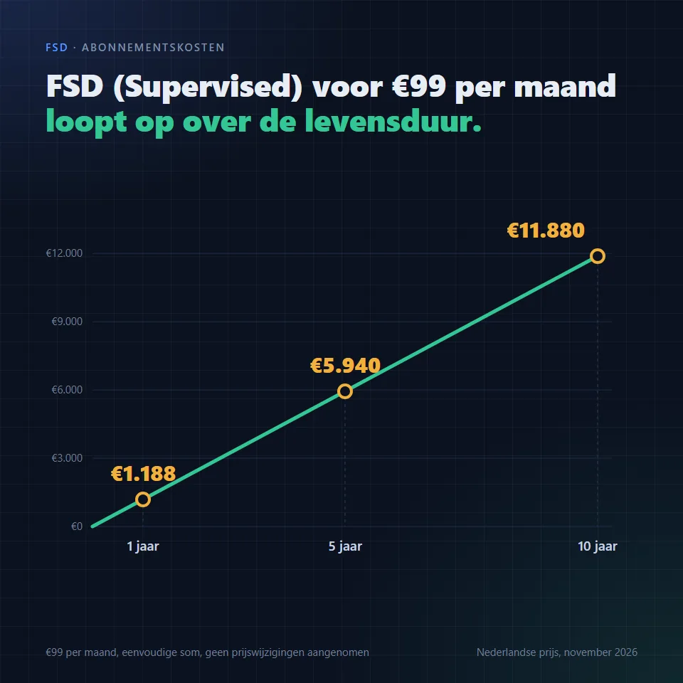
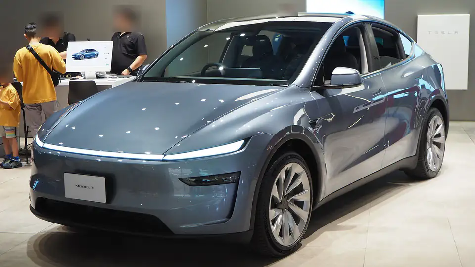
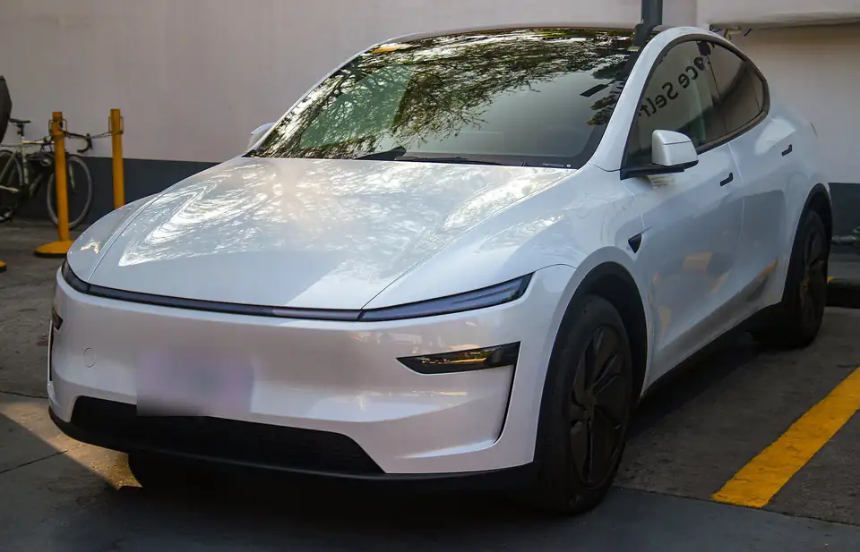
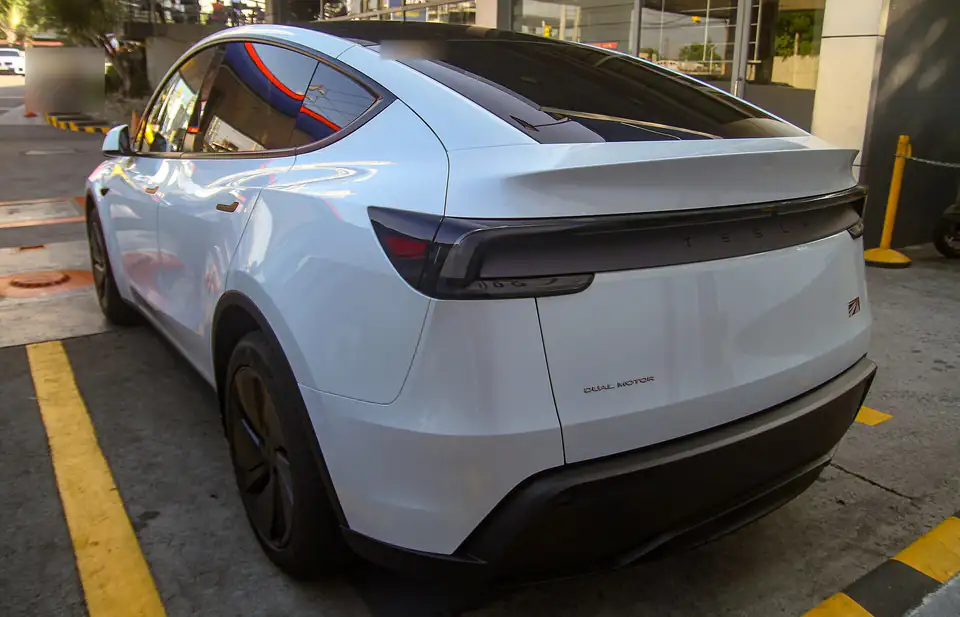
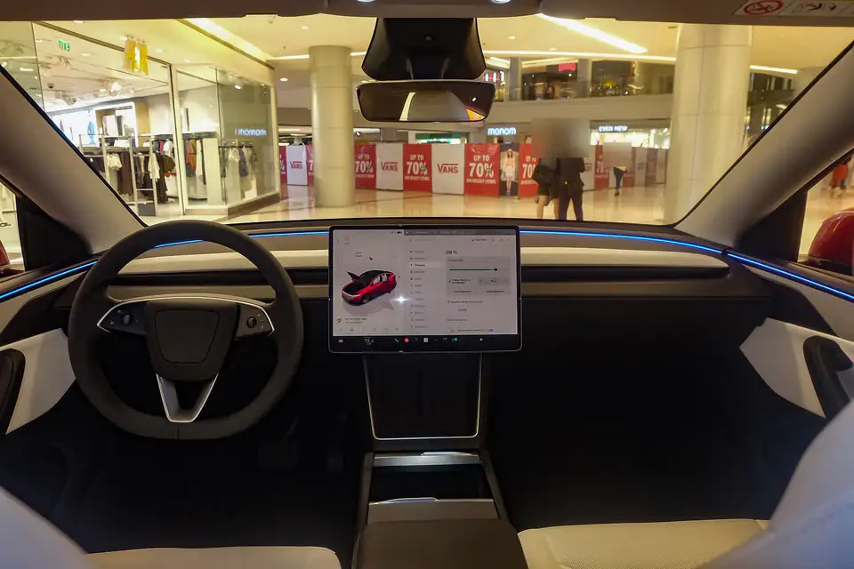
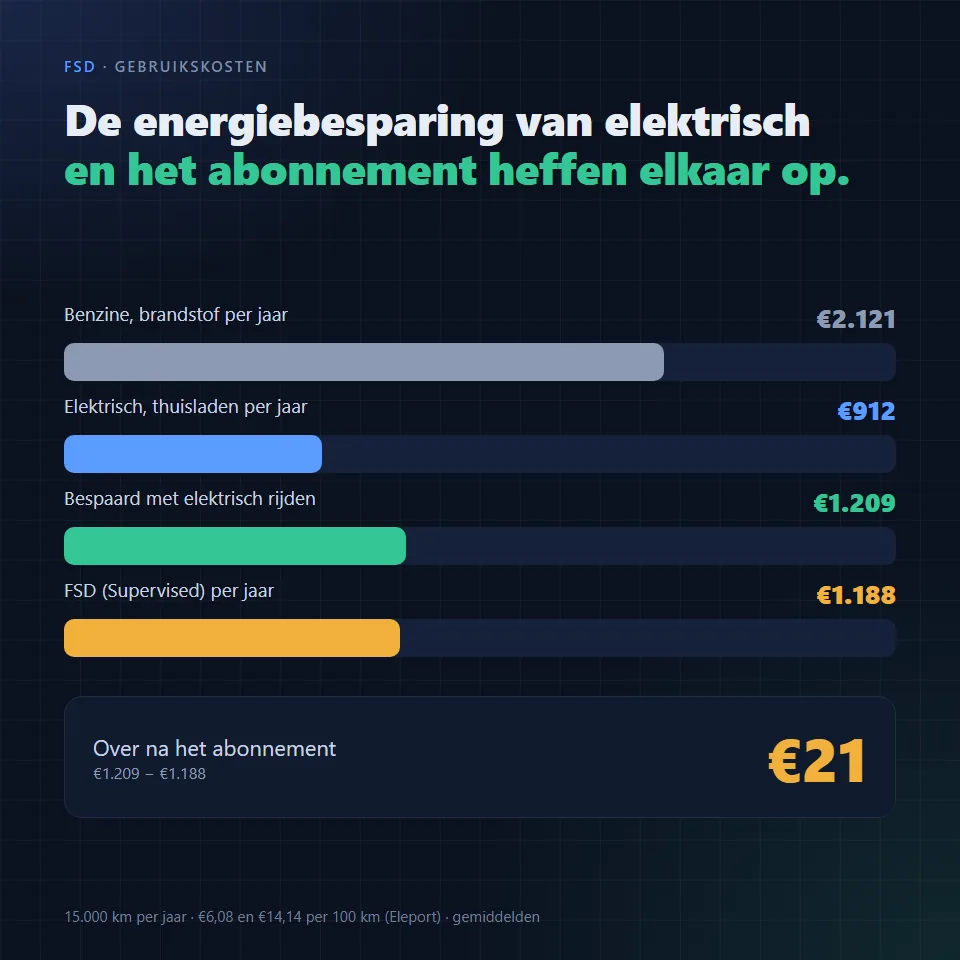
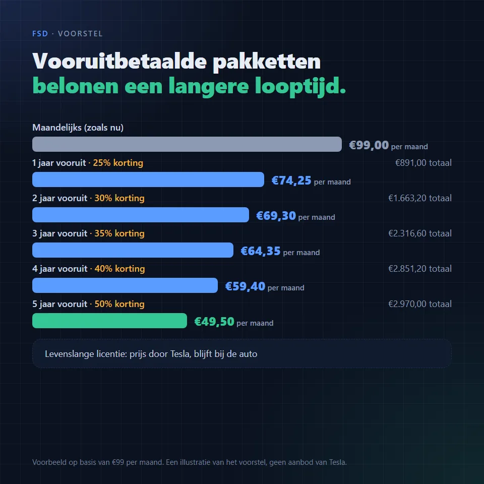

In Nederland kost Tesla FSD (Supervised) €99 per maand, en nieuwe kopers kunnen het niet meer eenmalig kopen. Ik vraag Tesla om naast het maandabonnement een eenmalige aankoop en vooruitbetaalde meerjarenpakketten aan te bieden. In dit artikel zet ik de feiten op een rij, de kosten over de levensduur van een auto en een concreet prijsvoorstel.

Mijn doel is een constructief gesprek met Tesla, geen aanval op het merk.

## Waarom dit voor mij belangrijk is

*[EIGENAARSVAK: de datum van levering, een of twee zinnen over de eerste rit en uw eigen screenshot van de Autopilot- en FSD-opties in de auto en in de Tesla-app. Verwijder deze regel als het is ingevuld.]*

In november 2026 nam ik een Tesla Model Y Premium Long Range AWD in ontvangst. Voordat ik koos, vergeleek ik meerdere elektrische auto’s. Toekomstige FSD-ondersteuning was voor mij belangrijk: ik viel af op een tweedehands Model S Plaid, omdat de Hardware 3-computer daarvan FSD (Supervised) niet ondersteunt, dat in Europa alleen voor auto’s met Hardware 4 is goedgekeurd. Daarom is de manier waarop deze functies worden verkocht belangrijk voor mij.

*De Tesla-foto’s op deze pagina zijn niet van mijn auto. Ze komen van Wikimedia Commons.*

*Tesla Model Y Long Range AWD (2025) in een showroom. Foto: Chanokchon, [CC BY-SA 4.0](https://creativecommons.org/licenses/by-sa/4.0/), via [Wikimedia Commons](https://commons.wikimedia.org/wiki/File:2025_Tesla_Model_Y_Juniper_Long_Range_AWD.jpg). Gezichten vervaagd, formaat aangepast. Een toonzaalauto, niet de mijne.*

*Tesla Model Y Performance, voorkant. Foto: Ethan Llamas, [CC BY-SA 4.0](https://creativecommons.org/licenses/by-sa/4.0/), via [Wikimedia Commons](https://commons.wikimedia.org/wiki/File:Tesla_Model_Y_Juniper_Performance_White_Pearl_01.jpg). Kenteken vervaagd, formaat aangepast. Dit is de Performance-uitvoering, niet mijn auto.*

*Tesla Model Y Performance, achterkant. Foto: Ethan Llamas, [CC BY-SA 4.0](https://creativecommons.org/licenses/by-sa/4.0/), via [Wikimedia Commons](https://commons.wikimedia.org/wiki/File:Tesla_Model_Y_Juniper_Performance_White_Pearl_02.jpg). Kenteken en een sticker vervaagd, mensen op de achtergrond vervaagd, formaat aangepast.*

## De feiten

Deze punten komen uit openbare bronnen, die onderaan dit artikel staan.

- FSD (Supervised) is goedgekeurd in Nederland. De RDW keurde het op 10 april 2026 goed voor auto’s met Hardware 4, en Electrek meldt het als de eerste goedkeuring in Europa ([Electrek, 14 april 2026](https://electrek.co/2026/04/14/tesla-fsd-europe-hw3-owners-dutch-claim/)).
- In Nederland kost FSD (Supervised) €99 per maand na een proefperiode van een maand ([teslablog.eu](https://teslablog.eu/blog/tesla-fsd-vs-enhanced-autopilot-europe-2026/), bijgewerkt op 3 oktober 2026; [Not a Tesla App](https://www.notateslaapp.com/news/3956/tesla-launches-fsd-subscriptions-in-the-netherlands)).
- Eenmalige aankoop is niet meer mogelijk. Die optie eindigde op 15 mei 2026 in Nederland en op 21 mei in het grootste deel van de rest van Europa ([Not a Tesla App](https://www.notateslaapp.com/news/4104/tesla-to-end-one-time-fsd-purchases-across-europe-this-month), [InsideEVs](https://insideevs.com/news/796684/tesla-fsd-subscription-europe/)). Tot dan kostte het €7.500 in de Nederlandse configurator ([Electrek, 12 mei 2026](https://electrek.co/2026/05/12/tesla-removes-basic-autopilot-netherlands-fsd-only/)). *[EIGENAARSVAK: controleer op de dag van publicatie tesla.com/nl_nl en schrijf op wat de configurator toont.]*
- Electrek meldt dat de Nederlandse basisauto niet langer rijstrookcentrering (Autosteer) heeft en dat Basic Autopilot bij nieuwe bestellingen niet meer als optie wordt aangeboden; de basisauto houdt alleen de noodrijstrookassistentie die de EU voorschrijft ([Electrek, 12 mei 2026](https://electrek.co/2026/05/12/tesla-removes-basic-autopilot-netherlands-fsd-only/)). *[EIGENAARSVAK: controleer dit op uw eigen auto, voeg uw screenshot toe en schrijf of adaptieve cruisecontrol nog is inbegrepen.]*
- Wettelijk verplichte veiligheidsfuncties blijven standaard. Onder de Europese General Safety Regulation zijn automatisch noodremmen en noodrijstrookassistentie verplicht op nieuwe auto’s ([Verordening (EU) 2019/2144](https://eur-lex.europa.eu/legal-content/EN/TXT/?uri=CELEX:32019R2144)) en vallen ze niet onder het abonnement. Dit artikel gaat over rijassistentie die apart wordt verkocht, niet over wettelijk verplichte veiligheidsfuncties.

*Stuur en middenscherm van een Tesla Model Y Long Range AWD. Foto: Ethan Llamas, [CC BY-SA 4.0](https://creativecommons.org/licenses/by-sa/4.0/), via [Wikimedia Commons](https://commons.wikimedia.org/wiki/File:Tesla_Model_Y_Juniper_Long_Range_AWD_White_%2B_Black_02.jpg). Gezichten vervaagd, formaat aangepast. Een toonzaalauto, niet de mijne.*

## De kosten over de levensduur van een auto

Bij €99 per maand loopt het abonnement zo op. De cijfers zijn 99 maal 12, 60 en 120 maanden.

| Periode | Totale kosten |
| --- | --- |
| 1 jaar | €1.188 |
| 5 jaar | €5.940 |
| 10 jaar | €11.880 |

Voor een auto die al rond de €55.000 kost ([catalogusprijs €54.990 voor de Model Y Premium Long Range AWD, AutoReview.nl, mei 2026](https://www.autoreview.nl/nieuws/id/37669/tesla-model-y-prijzen-1000-euro)), is dat een flinke extra uitgave. Volgens mij laten veel huishoudens de functie uit staan, terwijl de hardware ervoor al in hun auto zit.

## Waar de besparing van elektrisch rijden blijft

Mensen stappen onder meer over op een elektrische auto om hun gebruikskosten te verlagen. Het abonnement neemt het grootste deel van die besparing weer terug.

Voorbeeld bij 15.000 km per jaar met thuisladen, op basis van de kosten per 100 km uit één Europese vergelijking ([Eleport](https://eleport.com/are-electric-cars-cheaper-to-run/)), die EU-gemiddelden gebruikt:

| Post | Elektrisch | Benzine | Verschil |
| --- | --- | --- | --- |
| Energie of brandstof per jaar | €912 | €2.121 | €1.209 bespaard met de EV |
| FSD (Supervised)-abonnement per jaar | €1.188 | - | |
| Resterende energiebesparing na abonnement | | | €21 |

De berekening gaat uit van €6,08 per 100 km voor thuisladen en €14,14 per 100 km voor benzine. Ook de besparing op onderhoud is beperkt. Britse cijfers komen inclusief banden uit op £720 tot £1.180 per jaar voor een EV en £820 tot £1.530 voor een benzine- of dieselauto ([Dick Lovett](https://www.dicklovett.co.uk/electric/guides/electric-car-maintenance-costs)). Ik kon die pagina zelf niet openen; de cijfers komen uit de samenvatting in het zoekresultaat, dus wees voorzichtig.

Ik beweer niet dat elektrische auto’s in totaal duurder zijn. Aanschafprijs, belastingen, verzekering en waardeverlies veranderen het totaal. Mijn punt is specifieker: wie zich abonneert op FSD, levert bijna de hele energiebesparing in, en voor veel mensen is die besparing een belangrijke reden om over te stappen. Dat past slecht bij Tesla’s al langer bestaande missie om de wereldwijde overgang naar duurzame energie te versnellen, ook al heeft het bedrijf die zin inmiddels anders geformuleerd ([Gizmodo](https://gizmodo.com/elon-musk-has-changed-his-mission-statement-2000721530)).

*Dit zijn EU-gemiddelden. Een Model Y kan minder verbruiken dan de aangenomen 21 kWh per 100 km, en Nederlandse tarieven wijken af. Uw uitkomst hangt af van uw stroomtarief, kilometers en lokale brandstofprijzen. [EIGENAARSVAK: vervangen door uw eigen cijfers na een paar maanden rijden.]*

## Waarom de huidige aanpak volgens mij moet veranderen

De punten hieronder zijn mijn mening.

De hardware zit al in de auto en is al betaald. Elke nieuwe Model Y heeft de computer en camera’s die Tesla gebruikt voor FSD (Supervised), en de koper betaalt ervoor in de aanschafprijs. Maandelijks betalen voor hardware die ik al bezit, voelt meer als huren dan als bezitten.

Zonder aankoopoptie verdwijnt de keuze. Sommige eigenaren betalen liever maandelijks. Anderen betalen liever één keer en houden de functie zolang ze de auto hebben. Alleen een abonnement neemt die keuze weg.

Wat standaard was, moet standaard blijven. Als rijstrookcentrering eerder standaard was, krijgen kopers voor dezelfde prijs minder als die achter een betaalmuur verdwijnt.

Europese kopers verwachten duidelijke en blijvende rechten. Onder de [Richtlijn oneerlijke handelspraktijken](https://eur-lex.europa.eu/legal-content/EN/TXT/?uri=CELEX:32005L0029) kan een praktijk misleidend zijn als de presentatie als geheel de gemiddelde consument waarschijnlijk misleidt, ongeacht de bedoeling. Ik zeg niet dat Tesla deze wet overtreedt. Ik zeg dat de Europese verwachtingen over transparantie en eigendom hoog zijn, en dat prijzen daarbij moeten passen.

## De Europese juridische context

*Ik ben geen jurist. Onderstaande regels zijn context, geen bewering dat Tesla ze overtreedt. Of ze in een concreet geval van toepassing zijn, is aan toezichthouders en rechters.*

| EU-regel | Kort gezegd | Waarom relevant |
| --- | --- | --- |
| Richtlijn verkoop goederen (EU) 2019/771 | Bij goederen met digitale elementen moet de verkoper de updates leveren die nodig zijn om de goederen conform te houden, gedurende de periode die een consument redelijkerwijs mag verwachten | Het Europese recht ziet software die bij de auto wordt geleverd als onderdeel van het product |
| Richtlijn digitale inhoud (EU) 2019/770 | Consumenten hebben duidelijke rechten bij digitale inhoud en diensten, ook over de voorwaarden voor wijzigingen door de verkoper. Software die onder de koopovereenkomst bij de goederen wordt geleverd, valt in plaats daarvan onder 2019/771 | Een abonnement dat los van de auto wordt verkocht, kan onder deze richtlijn een digitale dienst zijn. Of dat zo is, is aan de rechter |
| Richtlijn oneerlijke handelspraktijken 2005/29/EG | Een praktijk kan misleidend zijn als de presentatie als geheel de gemiddelde consument waarschijnlijk misleidt, ook zonder opzet | De marketing van rijassistentie moet duidelijk zijn over wat er wordt geleverd, waar en tegen welke prijs |
| Richtlijn oneerlijke bedingen 93/13/EEG | De bijlage noemt bedingen die oneerlijk kunnen zijn, zoals bedingen waarmee een verkoper het product of de dienst zonder geldige reden wijzigt | Relevant als functies of voorwaarden na aankoop veranderen |
| Omnibusrichtlijn (EU) 2019/2161 | Strengere prijstransparantie en hogere boetes bij overtreding van het consumentenrecht | Legt de lat hoger voor duidelijke prijzen in de hele EU |

Geen van deze regels verbiedt abonnementen. Samen weerspiegelen ze een Europees principe: wat je koopt, moet transparant zijn, moet blijven werken zoals beloofd en mag niet eenzijdig in je nadeel veranderen.

## Hoe anderen met vergelijkbare kritiek omgingen

- BMW bood in sommige markten abonnementen aan op functies zoals stoelverwarming. Na kritiek van klanten maakte BMW in 2023 bekend dat het hardwarefuncties zoals stoelverwarming niet langer als abonnement zou verkopen. BMW hield abonnementen voor software wel aan, ook voor rij- en parkeerassistentie ([Motor1, 7 september 2023](https://www.motor1.com/news/685653/bmw-heated-seat-subscription-dead-low-acceptance/)).
- Tesla verkocht FSD in Europa zelf tot mei 2026 als eenmalige aankoop, in Nederland voor €7.500. Die optie terugbrengen is een terugkeer naar een model dat Tesla al kent.

Volgens mij kan het aanpassen van een model waar sommige klanten kritiek op hebben, een merk juist sterker maken.

## Andere zorgen van Europese eigenaren

- Eigenaren met Hardware 3 die duizenden euro’s voor FSD betaalden, organiseren zich via [hw3claim.nl](https://hw3claim.nl). In juni 2026 meldde Electrek circa 7.000 eigenaren en de steun van advocatenkantoor Kennedy Van der Laan voor een collectieve actie ([Electrek, 18 juni 2026](https://electrek.co/2026/06/18/tesla-hw3-claim-netherlands-7000-owners-kennedy-van-der-laan/)). De site noemt nu ongeveer 9.000 deelnemers en zegt dat Tesla twee sommatiebrieven heeft afgewezen. Electrek citeerde de organisatoren in april ook met het doel eerst met Tesla te onderhandelen, met een juridische claim als alternatief.
- FSD (Supervised) was in mei alleen in Nederland en Litouwen goedgekeurd ([ArenaEV, 23 mei 2026](https://www.arenaev.com/tesla_switches_to_subscriptiononly_full_selfdriving_in_europe-news-5907.php)). Medio november werd het in elf Europese landen gemeld, met Finland als elfde ([Evannex](https://evannex.com/blogs/news/finland-becomes-the-11th-european-country-to-approve-tesla-fsd-with-a-new-name)). Frankrijk, Duitsland, Italië en Zweden stonden niet op die lijst. Goedkeuring en marketing zijn verschillende dingen, daarom vraagt voorstel 6 om een duidelijk overzicht per land.

## Zes voorstellen aan Tesla

1. Breng de eenmalige aankoop terug. Laat eigenaren kiezen tussen een maandabonnement en een levenslange licentie die aan de auto gekoppeld is.
2. Maak rijstrookcentrering weer standaard. Als die niet meer is inbegrepen, moet elke nieuwe auto haar weer krijgen.
3. Voeg een goedkoper pakket toe, bijvoorbeeld alleen snelwegassistentie, met volledige FSD (Supervised) als premiumoptie.
4. Bied vooruitbetaalde jaar- en meerjarenpakketten aan, met een korting die langere looptijden beloont.
5. Maak een gekochte licentie overdraagbaar, zodat die bij verkoop bij de auto blijft.
6. Laat per land zien wat het abonnement levert en waar de goedkeuring nog ontbreekt.

## Een concreet prijsmodel

Om voorstel 4 concreet te maken, een voorbeeld op basis van de huidige prijs van €99 per maand. De kortingen zijn mijn eigen illustratie, geen aanbod van Tesla.

| Pakket | Korting | Totaalprijs | Effectief per maand | Besparing t.o.v. maandelijks |
| --- | --- | --- | --- | --- |
| Maandelijks (zoals nu) | 0% | €99 per maand | €99,00 | - |
| 1 jaar vooruit | 25% | €891,00 | €74,25 | €297,00 |
| 2 jaar vooruit | 30% | €1.663,20 | €69,30 | €712,80 |
| 3 jaar vooruit | 35% | €2.316,60 | €64,35 | €1.247,40 |
| 4 jaar vooruit | 40% | €2.851,20 | €59,40 | €1.900,80 |
| 5 jaar vooruit | 50% | €2.970,00 | €49,50 | €2.970,00 |
| Levenslange licentie | Eenmalige prijs | Vast te stellen door Tesla | - | Licentie blijft bij de auto |

Het 5-jarenpakket kost ongeveer €119 (€118,80) meer dan het 4-jarenpakket voor nog eens 12 maanden, waardoor de langste looptijd het aantrekkelijkst is.

Eerlijke voorwaarden voor vooruitbetaalde pakketten:

- Bij verkoop van de auto gaat de resterende periode mee met de auto of wordt die naar rato terugbetaald.
- Is FSD (Supervised) in het land van de eigenaar nog niet goedgekeurd, dan start de vooruitbetaalde periode pas na goedkeuring.
- Het maandabonnement blijft bestaan voor wie het af en toe nodig heeft, bijvoorbeeld voor een vakantie of een lange reis.

## Waarom dit ook goed kan zijn voor Tesla

- Vooruitbetaalde pakketten brengen eerder inkomsten binnen dan maandbetalingen.
- Een lagere effectieve prijs kan eigenaren aantrekken die de functie nu uit laten staan, en meer actieve gebruikers betekenen meer rijdata uit de praktijk.
- Eigenaren met een meerjarenpakket zeggen niet om de paar maanden op.
- Eigenaren die zich eerlijk behandeld voelen, bevelen het merk eerder aan en kopen er eerder opnieuw.
- In een concurrerende Europese markt kan een klantvriendelijk model een voordeel zijn.

## Vragen die ik verwacht

### Is een abonnement niet juist handig voor wie FSD af en toe nodig heeft?

Ja. Daarom vraag ik Tesla niet om het maandabonnement te schrappen, alleen om er keuzes naast te zetten.

### Gaat dit over veiligheidsfuncties?

Nee. Wettelijk verplichte veiligheidsfuncties, zoals automatisch noodremmen, zijn standaard. Dit artikel gaat over rijassistentie die apart wordt verkocht.

### Waarom dialoog en geen rechtszaak?

Volgens mij is een oplossing via dialoog meestal sneller en beter voor iedereen. Juridische stappen, zoals de collectieve actie van Hardware 3-eigenaren, zijn een terugvaloptie als dialoog niet werkt.

### Bent u tegen Tesla?

Nee. Ik heb er net een gekocht en wil dat het merk het goed doet in Europa. Juist daarom breng ik dit ter sprake.

## Wat u kunt doen

Als u deze zorgen deelt:

- Deel uw ervaring in de reacties of op sociale media, met feiten en in respectvolle taal.
- Geef feedback aan Tesla via de Tesla-app of de klantenservice van Tesla.
- Neem contact op met een consumentenorganisatie, zoals de Consumentenbond, of met BEUC op Europees niveau.
- Meld een praktijk die u onduidelijk of misleidend vindt bij de ACM (Autoriteit Consument & Markt) via ConsuWijzer.
- Eigenaren met Hardware 3 kunnen kijken op hw3claim.nl.

Ik wil eigenaren samenbrengen die hier constructief over willen praten. Hoort u daarbij, neem dan contact op via de contactpagina van deze site. *[EIGENAARSVAK: link naar uw contactpagina.]*

*Dit artikel is mijn persoonlijke mening als Tesla-eigenaar en geen juridisch advies. Feiten per november 2026, uit de bronnen hieronder.*

## Bronnen

Alle links zijn op 2026-11-19 geopend, tenzij anders vermeld.

- Electrek, Tesla-goedkeuring in Nederland en de HW3-claim (2026-04-14): https://electrek.co/2026/04/14/tesla-fsd-europe-hw3-owners-dutch-claim/
- Electrek, Tesla verplaatst Basic Autopilot-functies naar betaalde FSD (2026-05-12): https://electrek.co/2026/05/12/tesla-removes-basic-autopilot-netherlands-fsd-only/
- Electrek, HW3-claim groeit tot 7.000 eigenaren (2026-06-18): https://electrek.co/2026/06/18/tesla-hw3-claim-netherlands-7000-owners-kennedy-van-der-laan/
- teslablog.eu, Tesla FSD vs Enhanced Autopilot in Europe 2026: https://teslablog.eu/blog/tesla-fsd-vs-enhanced-autopilot-europe-2026/
- Not a Tesla App, FSD-abonnementen in Nederland: https://www.notateslaapp.com/news/3956/tesla-launches-fsd-subscriptions-in-the-netherlands
- Not a Tesla App, einde van eenmalige FSD-aankoop in Europa: https://www.notateslaapp.com/news/4104/tesla-to-end-one-time-fsd-purchases-across-europe-this-month
- InsideEVs, FSD-abonnement in Europa: https://insideevs.com/news/796684/tesla-fsd-subscription-europe/
- ArenaEV, Tesla stapt in Europa over op FSD alleen met abonnement (2026-05-23): https://www.arenaev.com/tesla_switches_to_subscriptiononly_full_selfdriving_in_europe-news-5907.php
- Evannex, Finland is het 11e Europese land dat Tesla FSD goedkeurt: https://evannex.com/blogs/news/finland-becomes-the-11th-european-country-to-approve-tesla-fsd-with-a-new-name
- hw3claim.nl: https://hw3claim.nl
- Eleport, Zijn elektrische auto’s echt duurder dan benzineauto’s? (EU-gemiddelden van 21 kWh per 100 km à €0,2896 per kWh, en 7,4 liter per 100 km à €1,91 per liter): https://eleport.com/are-electric-cars-cheaper-to-run/
- Dick Lovett, onderhoudskosten van elektrische auto’s in het VK (Britse cijfers; de pagina blokkeerde mijn automatische lezer, de cijfers komen uit het zoekresultaat): https://www.dicklovett.co.uk/electric/guides/electric-car-maintenance-costs
- Motor1, BMW-abonnement op stoelverwarming (2023-09-07): https://www.motor1.com/news/685653/bmw-heated-seat-subscription-dead-low-acceptance/
- AutoReview.nl, prijzen Tesla Model Y (2026-05-02): https://www.autoreview.nl/nieuws/id/37669/tesla-model-y-prijzen-1000-euro
- Gizmodo, Musk heeft de missie van Tesla veranderd (2026-02-14): https://gizmodo.com/elon-musk-has-changed-his-mission-statement-2000721530
- Verordening (EU) 2019/2144, General Safety Regulation: https://eur-lex.europa.eu/legal-content/EN/TXT/?uri=CELEX:32019R2144
- Richtlijn (EU) 2019/770, digitale inhoud en diensten: https://eur-lex.europa.eu/legal-content/EN/TXT/?uri=CELEX:32019L0770
- Richtlijn (EU) 2019/771, verkoop van goederen: https://eur-lex.europa.eu/legal-content/EN/TXT/?uri=CELEX:32019L0771
- Richtlijn 2005/29/EG, oneerlijke handelspraktijken: https://eur-lex.europa.eu/legal-content/EN/TXT/?uri=CELEX:32005L0029
- Richtlijn 93/13/EEG, oneerlijke bedingen: https://eur-lex.europa.eu/legal-content/EN/TXT/?uri=CELEX:31993L0013
- Richtlijn (EU) 2019/2161, Omnibus: https://eur-lex.europa.eu/legal-content/EN/TXT/?uri=CELEX:32019L2161

Foto’s van Wikimedia Commons, aangepast zoals beschreven en onder dezelfde licentie gedeeld, CC BY-SA 4.0 (https://creativecommons.org/licenses/by-sa/4.0/):

- Omslagfoto (alleen zichtbaar op de blogindex), Tesla Model Y Performance (2025), Alexander Migl. Kenteken vervaagd, formaat aangepast, licht afgevlakt: https://commons.wikimedia.org/wiki/File:Tesla_Model_Y_Performance_%282025%29_autoMOBIL_T%C3%BCbingen_2025_DSC_2801.jpg
- Tesla Model Y Long Range AWD in een showroom, Chanokchon. Gezichten vervaagd, formaat aangepast: https://commons.wikimedia.org/wiki/File:2025_Tesla_Model_Y_Juniper_Long_Range_AWD.jpg
- Tesla Model Y Performance, voorkant, Ethan Llamas. Kenteken vervaagd, formaat aangepast: https://commons.wikimedia.org/wiki/File:Tesla_Model_Y_Juniper_Performance_White_Pearl_01.jpg
- Tesla Model Y Performance, achterkant, Ethan Llamas. Een sticker en mensen op de achtergrond vervaagd, formaat aangepast: https://commons.wikimedia.org/wiki/File:Tesla_Model_Y_Juniper_Performance_White_Pearl_02.jpg
- Tesla Model Y Long Range AWD, stuur en middenscherm, Ethan Llamas. Mensen op de achtergrond vervaagd, formaat aangepast: https://commons.wikimedia.org/wiki/File:Tesla_Model_Y_Juniper_Long_Range_AWD_White_%2B_Black_02.jpg
