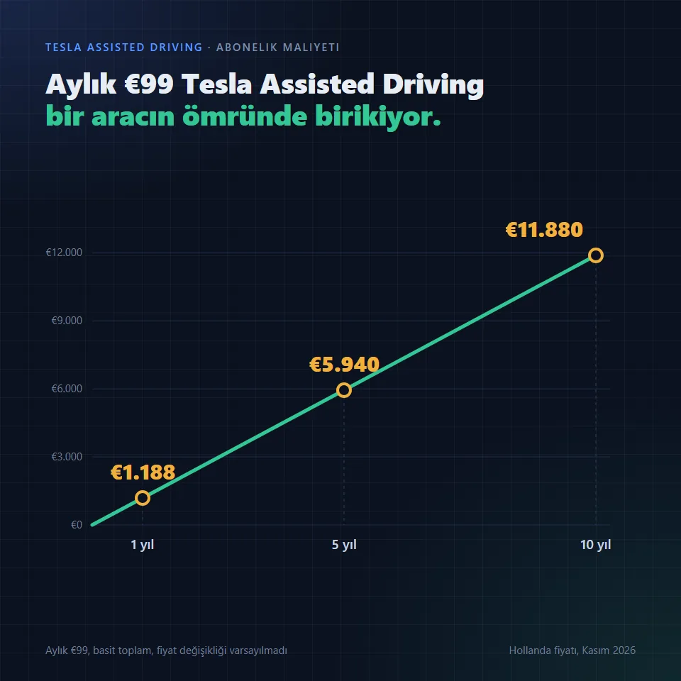
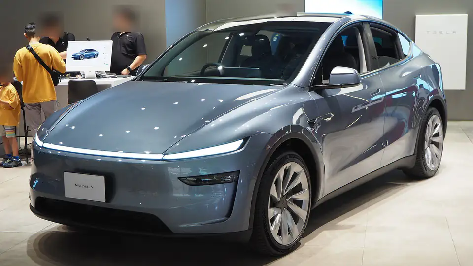
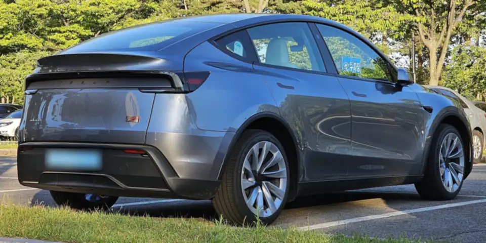
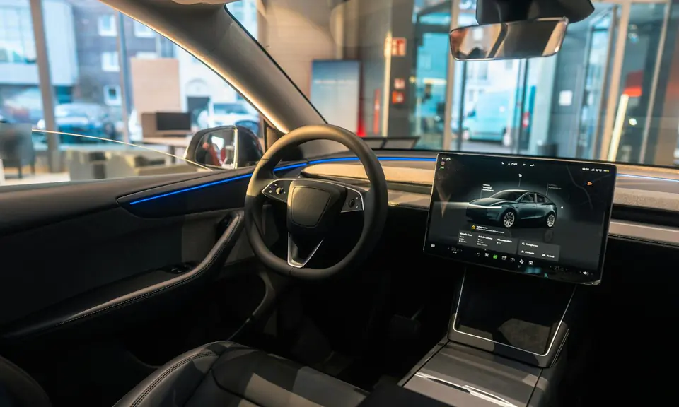
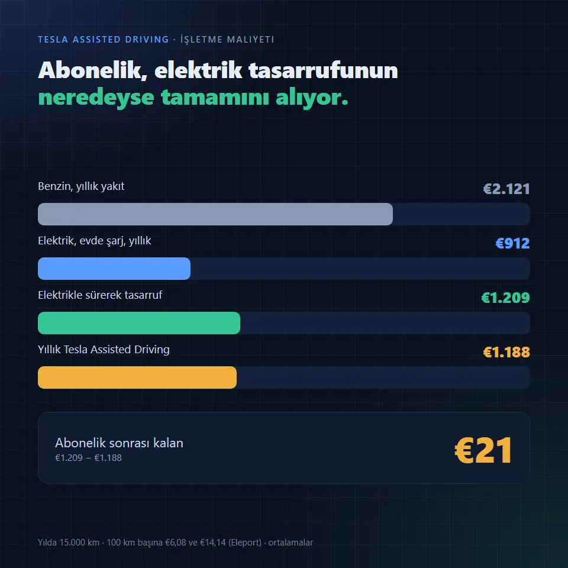
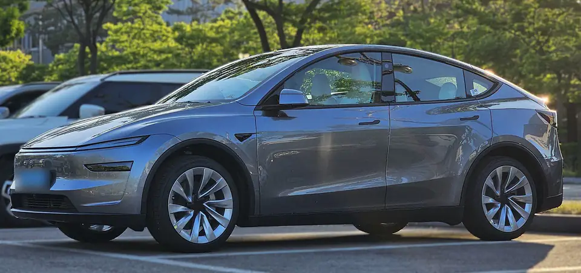
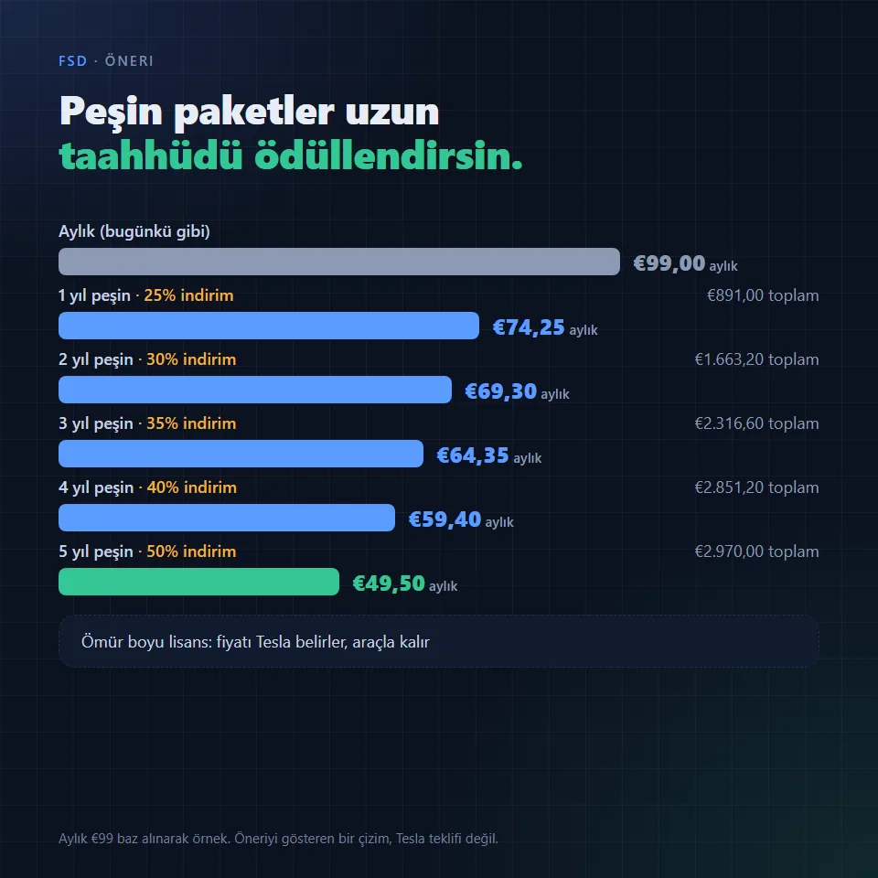

Hollanda’da Tesla Assisted Driving, yani FSD (Supervised) olarak satılanın Avrupa’daki adı, aylık €99 ve yeni alıcılar artık bu özelliği tek seferde satın alamıyor. Tesla’dan aylık aboneliğin yanında tek seferlik satın alma ve peşin ödemeli çok yıllık paketler sunmasını istiyorum. Bu yazıda gerçekleri, bir aracın ömrü boyunca maliyeti ve somut bir fiyat önerisini paylaşıyorum.

Amacım Tesla ile yapıcı bir diyalog kurmak, markaya saldırmak değil.

## Bu konu benim için neden önemli

Bir Tesla Model Y Premium Long Range AWD satın aldım. Satın almadan önce test sürüşü yaptım ve birçok elektrikli aracı karşılaştırdım. Diğer markalarla kıyasladığımda Tesla deneyimim daha iyiydi, bu yüzden Tesla’yı seçtim. Gelecekte Tesla Assisted Driving desteği benim için önemliydi: ikinci el bir Model S Plaid’i, Hardware 3 bilgisayarı onu desteklemediği ve Avrupa’da yalnızca Hardware 4’lü araçlar için onaylandığı için eledim. Tesla’da beğenmediğim tek şey, Tesla Assisted Driving’in yalnızca abonelikle sunulması ve bence pahalı olması. Bu özelliklerin nasıl satıldığı da bu yüzden benim için önemli.

*Showroom’da Tesla Model Y Long Range AWD (2025). Fotoğraf: Chanokchon, [CC BY-SA 4.0](https://creativecommons.org/licenses/by-sa/4.0/), [Wikimedia Commons](https://commons.wikimedia.org/wiki/File:2025_Tesla_Model_Y_Juniper_Long_Range_AWD.jpg) aracılığıyla. Yüzler bulanıklaştırıldı, boyutu küçültüldü. Sergi aracı, benim aracım değil.*

*Quicksilver renginde Tesla Model Y Dual Motor (AWD) (2025). Fotoğraf: Damian B Oh, [CC BY-SA 4.0](https://creativecommons.org/licenses/by-sa/4.0/), [Wikimedia Commons](https://commons.wikimedia.org/wiki/File:Tesla_Model_Y_Dual_Motor_First_Edition_Juniper_Quicksilver_%2816%29.jpg) aracılığıyla. Plaka bulanıklaştırıldı, kırpıldı ve boyutu küçültüldü. Benim aracım değil.*

## Gerçekler

Bu bilgiler, yazının sonunda listelenen kamuya açık kaynaklardan alındı.

- Avrupa’da Tesla, FSD (Supervised) olarak satılan ürünü artık Tesla Assisted Driving adıyla satıyor ([Tesla Hollanda](https://www.tesla.com/nl_nl/tesla-assisted-driving)). Tesla’nın sayfası, şu anda sunulan özelliklerin sürücünün aktif gözetimini gerektirdiğini ve aracı otonom yapmadığını belirtiyor. Bu yazı bugünkü ürün için Tesla Assisted Driving adını kullanıyor; kaynakların ve geçmişin FSD dediği yerlerde FSD’yi koruyor.
- Hollanda araç kurumu RDW, FSD (Supervised)’ı (şimdiki adıyla Tesla Assisted Driving) 10 Nisan 2026’da Hardware 4’lü araçlar için onayladı; Electrek bunu Avrupa’daki ilk onay olarak bildiriyor ([Electrek, 14 Nisan 2026](https://electrek.co/2026/04/14/tesla-fsd-europe-hw3-owners-dutch-claim/)).
- Hollanda’da Tesla Assisted Driving, bir aylık deneme süresinin ardından aylık €99 ([teslablog.eu](https://teslablog.eu/blog/tesla-fsd-vs-enhanced-autopilot-europe-2026/), 3 Ekim 2026’da güncellendi; [Not a Tesla App](https://www.notateslaapp.com/news/3956/tesla-launches-fsd-subscriptions-in-the-netherlands)). Tesla’nın Hollanda sayfası bunu aylık €99’luk bir abonelik olarak listeliyor ve Model Y yapılandırıcısı, faturalandırma başlamadan önce bir aylık deneme süresi gösteriyor ([Tesla Hollanda](https://www.tesla.com/nl_nl/tesla-assisted-driving), [yapılandırıcı](https://www.tesla.com/nl_nl/modely/design), ikisi de 19 Kasım 2026’da kontrol edildi).
- Tek seferlik satın alma seçeneği kalktı. Hollanda’da 15 Mayıs 2026’da, Avrupa’nın geri kalanının çoğunda 21 Mayıs’ta sona erdi ([Not a Tesla App](https://www.notateslaapp.com/news/4104/tesla-to-end-one-time-fsd-purchases-across-europe-this-month), [InsideEVs](https://insideevs.com/news/796684/tesla-fsd-subscription-europe/)). O zamana kadar Hollanda yapılandırıcısında €7.500’dü ([Electrek, 12 Mayıs 2026](https://electrek.co/2026/05/12/tesla-removes-basic-autopilot-netherlands-fsd-only/)). Tesla’nın Hollanda Model Y yapılandırıcısında, 19 Kasım 2026’da kontrol edildiğinde, Tesla Assisted Driving yalnızca aylık abonelik olarak sunuluyor; tek seferlik satın alma seçeneği yok ([Tesla Hollanda yapılandırıcısı](https://www.tesla.com/nl_nl/modely/design)).
- Electrek, Hollanda’daki baz araçta artık şerit ortalamanın (Autosteer) gelmediğini ve yeni siparişlerde Basic Autopilot’un artık seçenek olarak sunulmadığını bildiriyor; baz araçta yalnızca AB yasasının zorunlu kıldığı acil şerit koruma kalıyor ([Electrek, 12 Mayıs 2026](https://electrek.co/2026/05/12/tesla-removes-basic-autopilot-netherlands-fsd-only/)).
- Kendi aracımda adaptif hız sabitleyici abonelik olmadan dahil, şerit ortalama (Autosteer) ise abonelik gerektiriyor.
- AB yasasının zorunlu kıldığı güvenlik özellikleri standart kalıyor. AB Genel Güvenlik Yönetmeliği’ne göre otomatik acil fren ve acil şerit koruma yeni araçlarda zorunlu ([Yönetmelik (AB) 2019/2144](https://eur-lex.europa.eu/legal-content/EN/TXT/?uri=CELEX:32019R2144)) ve aboneliğe dahil değil. Bu yazı yasal zorunlu güvenlik özellikleriyle değil, ayrıca satılan sürüş destek özellikleriyle ilgili.

*Hannover’deki Tesla Center’da bir Tesla Model Y’nin içi. Fotoğraf: Maxim, [Unsplash](https://unsplash.com/photos/the-interior-of-a-car-with-a-laptop-on-the-dashboard-I7GNlRbI9HA), Unsplash Lisansı kapsamında kullanıldı. Arka plandaki bir kişi bulanıklaştırıldı, kırpıldı ve boyutu küçültüldü. Benim aracım değil.*

## Tesla Assisted Driving nedir

Tesla Assisted Driving, Tesla’nın sürüş destek paketi. Tesla’nın [Hollanda sayfası](https://www.tesla.com/nl_nl/tesla-assisted-driving), paketin günlük sürüşleri, hata riski yüksek yaygın sürüş görevleri dahil, üstlenebildiğini söylüyor; 360 derecelik görüş sağlayan dış kameralar kullandığını ve kablosuz yazılım güncellemelerinin en yeni güvenlik iyileştirmelerini getirdiğini belirtiyor. Tesla ayrıca şu anda sunulan özelliklerin sürücünün aktif gözetimini gerektirdiğini ve aracı otonom yapmadığını belirtiyor.

Sayfada Tesla’nın kendi rakamları da var (19 Kasım 2026’da kontrol edildi). Tesla, Tesla Assisted Driving etkinken insan sürücüden yedi kat daha güvenli olduğunu, bunu ABD ortalamasına ilişkin kendi tahminiyle kıyasladığını ve 100 yıldan fazla gerçek sürüş deneyimiyle eğitildiğini söylüyor. Bunlar Tesla’nın kendi iddiaları, bağımsız veri değil.

| Artılar | Eksiler |
| --- | --- |
| Rutin sürüşleri gözetiminiz altında yapar | Gözetim her zaman gerekir; araç otonom değil |
| Düzenli kablosuz güncellemeler | Yalnızca abonelikle |
| Faturalandırma başlamadan bir aylık deneme | Hollanda’daki yeni siparişlerde şerit ortalama artık standart değil |
| On bir Avrupa ülkesinde onaylandığı bildiriliyor | Onay ülkeye göre değişiyor |

## Bir aracın ömrü boyunca maliyet

Aylık €99 ile abonelik şöyle birikiyor. Rakamlar 99 çarpı 12, 60 ve 120 ay.

| Süre | Toplam maliyet |
| --- | --- |
| 1 yıl | €1.188 |
| 5 yıl | €5.940 |
| 10 yıl | €11.880 |

Zaten €54.990 olan bir araç için (Model Y Premium Long Range AWD’nin Hollanda yapılandırıcısındaki fiyatı, [19 Kasım 2026’da kontrol edildi](https://www.tesla.com/nl_nl/modely/design)) bu ciddi bir ek masraf. Bence birçok hane, donanımı araçlarında olduğu hâlde bu özelliği kapalı tutacak.

## Elektrikliye geçişin tasarrufu nereye gidiyor

İnsanlar elektrikli araca kısmen işletme maliyetlerini düşürmek için geçiyor. Abonelik bu tasarrufun büyük kısmını geri alıyor.

Yılda 15.000 km ve evde şarj için, Avrupa’daki bir karşılaştırmanın ([Eleport](https://eleport.com/are-electric-cars-cheaper-to-run/)) 100 km maliyetleriyle bir örnek; karşılaştırma AB ortalamalarını kullanıyor:

| Yıllık | Elektrikli | Benzinli | Fark |
| --- | --- | --- | --- |
| Enerji veya yakıt | €912 | €2.121 | €1.209 |
| Tesla Assisted Driving aboneliği | €1.188 | - | |
| Abonelik sonrası kalan | | | €21 |

Elektrikli araç enerjide yılda €1.209 tasarruf ettiriyor; abonelikten sonra €21 kalıyor.

Hesaplamada evde şarj için 100 km başına €6,08, benzin için €14,14 baz alındı. Bakımdaki tasarruf da sınırlı. İngiltere verilerine göre lastik dahil yıllık bakım, elektrikli araçta £720 ile £1.180, benzinli veya dizel araçta £820 ile £1.530 arasında ([Dick Lovett](https://www.dicklovett.co.uk/electric/guides/electric-car-maintenance-costs)). Bu sayfayı kendim açamadım; rakamlar arama sonucundaki özetten, bu yüzden temkinle okuyun.

Elektrikli araçların toplamda daha pahalı olduğunu iddia etmiyorum. Satın alma fiyatı, vergiler, sigorta ve değer kaybı toplamı değiştirir. Söylediğim daha dar kapsamlı: Tesla Assisted Driving’e abone olan bir sahip, enerji tasarrufunun neredeyse tamamını geri ödüyor ve birçok insan için bu tasarruf elektrikliye geçmenin başlıca sebeplerinden biri. Bu, Tesla’nın dünyanın sürdürülebilir enerjiye geçişini hızlandırma yönündeki uzun süredir bilinen misyonuyla zor bağdaşıyor; şirket misyon cümlesini sonradan değiştirmiş olsa da ([Gizmodo](https://gizmodo.com/elon-musk-has-changed-his-mission-statement-2000721530)).

*Bunlar AB ortalamaları. Bir Model Y varsayılan 100 km başına 21 kWh’den daha az tüketebilir ve Hollanda tarifeleri farklı. Sonuç elektrik tarifene, kilometrene ve yerel yakıt fiyatlarına bağlı.*

## Mevcut yaklaşım neden değişmeli

Aşağıdakiler benim görüşüm.

*Quicksilver renginde Tesla Model Y Dual Motor (AWD) (2025). Fotoğraf: Damian B Oh, [CC BY-SA 4.0](https://creativecommons.org/licenses/by-sa/4.0/), [Wikimedia Commons](https://commons.wikimedia.org/wiki/File:Tesla_Model_Y_Dual_Motor_First_Edition_Juniper_Quicksilver_%2810%29.jpg) aracılığıyla. Plaka ve bir yoldan geçen kişi bulanıklaştırıldı, kırpıldı ve boyutu küçültüldü. Benim aracım değil.*

Donanım zaten araçta ve parası ödendi. Her yeni Model Y, Tesla’nın Tesla Assisted Driving için kullandığı bilgisayar ve kameralarla geliyor ve alıcı bunların bedelini satın alma fiyatında ödüyor. Zaten sahip olduğum donanımı kullanmak için her ay ödemek, sahiplikten çok kiralamaya benziyor.

Satın alma seçeneğinin kalkması tercih hakkını ortadan kaldırıyor. Bazı sahipler aylık ödemeyi tercih eder. Bazıları ise bir kez ödeyip özelliği araç kendisinde olduğu sürece kullanmak ister. Sadece abonelik sunmak bu tercihi elinden alıyor.

Standart olan, standart kalmalı. Şerit ortalama daha önce standartsa, onun ücretli pakete alınması aynı fiyata daha azı demek. Kendi aracımda adaptif hız sabitleyici hâlâ dahil; abonelik arkasında olan şerit ortalama.

Avrupalı alıcılar açık ve kalıcı haklar bekler. [Haksız Ticari Uygulamalar Direktifi](https://eur-lex.europa.eu/legal-content/EN/TXT/?uri=CELEX:32005L0029) uyarınca bir uygulama, genel sunumu ortalama tüketiciyi yanıltabiliyorsa, kasıt olmasa da yanıltıcı sayılabilir. Tesla’nın bu yasayı çiğnediğini söylemiyorum. Avrupa’da şeffaflık ve sahiplik beklentisinin yüksek olduğunu ve fiyatlandırmanın buna uyması gerektiğini söylüyorum.

## Avrupa’daki hukuki çerçeve

*Hukukçu değilim. Aşağıdaki kurallar bağlam içindir; Tesla’nın bunları ihlal ettiği iddiası değildir. Somut bir durumda uygulanıp uygulanmadıklarına denetim kurumları ve mahkemeler karar verir.*

| AB kuralı | Kısaca ne diyor | Neden önemli |
| --- | --- | --- |
| Mal Satış Direktifi (AB) 2019/771 | Dijital unsurlu mallarda satıcı, ürünü tüketicinin makul olarak bekleyebileceği süre boyunca sözleşmeye uygun tutacak güncellemeleri sağlamalı | AB hukuku, araçla birlikte gelen yazılımı ürünün parçası olarak görür |
| Dijital İçerik Direktifi (AB) 2019/770 | Tüketicilerin dijital içerik ve hizmetlerde, satıcının yaptığı değişikliklerin koşulları dahil, açık hakları var. Satış sözleşmesi kapsamında malla birlikte gelen yazılım bunun yerine 2019/771 kapsamında | Araçtan ayrı satılan bir abonelik bu direktif kapsamında dijital hizmet olabilir. Olup olmadığına mahkemeler karar verir |
| Haksız Ticari Uygulamalar Direktifi 2005/29/AT | Genel sunumu ortalama tüketiciyi yanıltabilecek bir uygulama, kasıt olmasa da yanıltıcı sayılabilir | Sürüş desteği pazarlaması neyin, nerede ve hangi fiyata sunulduğu konusunda açık olmalı |
| Haksız Sözleşme Şartları Direktifi 93/13/AET | Eki, haksız olabilecek şartları sıralar; örneğin satıcının ürünü veya hizmeti geçerli bir sebep olmadan değiştirmesine izin veren şartlar | Satın alma sonrası özellik veya koşulların değişmesiyle ilgili |
| Omnibus Direktifi (AB) 2019/2161 | Fiyat şeffaflığını güçlendirdi ve tüketici hukuku ihlallerinde cezaları artırdı | AB genelinde açık fiyatlandırma çıtasını yükseltir |

Bu kuralların hiçbiri aboneliği yasaklamıyor. Birlikte bir Avrupa ilkesini yansıtıyorlar: satın aldığın şey şeffaf olmalı, vaat edildiği gibi çalışmaya devam etmeli ve aleyhine tek taraflı değişmemeli.

## Diğer markalar benzer eleştirilere nasıl yaklaştı

- BMW, bazı pazarlarda ısıtmalı koltuk gibi özellikler için abonelik sundu. Müşteri eleştirilerinin ardından 2023’te ısıtmalı koltuk gibi donanım özelliklerini artık abonelikle satmayacağını açıkladı. BMW yazılım abonelikleri, sürüş ve park desteği dahil, sürdürüyor ([Motor1, 7 Eylül 2023](https://www.motor1.com/news/685653/bmw-heated-seat-subscription-dead-low-acceptance/)).
- Tesla’nın kendisi FSD’yi Avrupa’da Mayıs 2026’ya kadar tek seferlik satın alma ile sattı; Hollanda’da fiyatı €7.500’dü. Bu seçeneği geri getirmek, Tesla’nın zaten bildiği bir modele dönmek olur.

Bence bazı müşterilerin eleştirdiği bir modeli değiştirmek markayı güçlendirebilir.

## Avrupalı sahiplerin diğer kaygıları

- FSD için binlerce euro ödemiş Hardware 3 sahipleri [hw3claim.nl](https://hw3claim.nl) üzerinden örgütleniyor. Electrek Haziran 2026’da yaklaşık 7.000 sahibe ulaşıldığını ve toplu dava için Kennedy Van der Laan hukuk bürosunun desteğini bildirdi ([Electrek, 18 Haziran 2026](https://electrek.co/2026/06/18/tesla-hw3-claim-netherlands-7000-owners-kennedy-van-der-laan/)). Site şimdi yaklaşık 9.000 katılımcı gösteriyor ve Tesla’nın iki ihtarnameyi reddettiğini söylüyor. Electrek ayrıca Nisan’da organizatörlerin önce Tesla ile müzakere etmeyi, olmazsa hukuki yolu hedeflediğini aktardı.
- FSD (Supervised) Mayıs’ta yalnızca Hollanda ve Litvanya’da onaylıydı ([ArenaEV, 23 Mayıs 2026](https://www.arenaev.com/tesla_switches_to_subscriptiononly_full_selfdriving_in_europe-news-5907.php)). Kasım ortasında on bir Avrupa ülkesinde olduğu bildirildi, on birincisi Finlandiya ([Evannex](https://evannex.com/blogs/news/finland-becomes-the-11th-european-country-to-approve-tesla-fsd-with-a-new-name)). Fransa, Almanya, İtalya ve İsveç bu listede yoktu. Onay ile pazarlama ayrı şeyler; altıncı öneri bu yüzden ülke ülke açık bir görünüm istiyor.

## Tesla’ya altı öneri

1. Tek seferlik satın almayı geri getirin. Sahipler aylık abonelik ile araca bağlı ömür boyu lisans arasında seçim yapabilsin.
2. Şerit ortalamayı yeniden standart yapın. Artık dahil değilse, her yeni araçla yeniden gelmeli.
3. Daha uygun fiyatlı bir paket ekleyin; örneğin sadece otoyol asistanı, tam Tesla Assisted Driving ise premium seçenek olsun.
4. Uzun süreli taahhüdü ödüllendiren indirimli, peşin ödemeli yıllık ve çok yıllık paketler sunun.
5. Satın alınan lisansı devredilebilir yapın, araç satıldığında araçla birlikte kalsın.
6. Aboneliğin her ülkede neler sunduğunu ve onayın nerede beklendiğini açıkça gösterin.

## Somut bir fiyat modeli

Dördüncü öneriyi somutlaştırmak için, bugünkü aylık €99 fiyatı baz alınarak bir örnek. İndirimler benim kendi örneğim, Tesla teklifi değil.

| Paket | İndirim | Toplam | Aylık | Aylığa göre tasarruf |
| --- | --- | --- | --- | --- |
| Aylık, bugünkü gibi (aylık €99) | %0 | - | €99,00 | - |
| 1 yıl peşin | %25 | €891,00 | €74,25 | €297,00 |
| 2 yıl peşin | %30 | €1.663,20 | €69,30 | €712,80 |
| 3 yıl peşin | %35 | €2.316,60 | €64,35 | €1.247,40 |
| 4 yıl peşin | %40 | €2.851,20 | €59,40 | €1.900,80 |
| 5 yıl peşin | %50 | €2.970,00 | €49,50 | €2.970,00 |

Fiyatını Tesla’nın belirlediği bir ömür boyu lisans araçla birlikte kalırdı.

5 yıllık paket, 4 yıllıktan 12 ay daha fazla süre için yaklaşık €119 (€118,80) daha pahalı; bu da en uzun taahhüdü en cazip seçenek yapıyor.

Peşin paketler için adil koşullar:

- Araç satılırsa kalan süre araçla birlikte devredilir ya da orantılı olarak iade edilir.
- Tesla Assisted Driving sahibin ülkesinde henüz onaylı değilse, peşin süre onaydan sonra başlar.
- Ara sıra ihtiyaç duyanlar için aylık seçenek devam eder; örneğin bir tatil veya uzun bir yolculuk için.

## Bu neden Tesla için de iyi olabilir

- Peşin paketler geliri aylık ödemelerden daha önce getirir.
- Daha düşük efektif fiyat, bugün özelliği kapalı tutan sahipleri kazandırabilir; daha fazla aktif kullanıcı da daha fazla gerçek sürüş verisi demek olur.
- Çok yıllık paketteki sahipler birkaç ayda bir aboneliği iptal etmez.
- Adil davranıldığını hisseden sahiplerin markayı tavsiye etme ve ondan yeniden alma olasılığı daha yüksek.
- Rekabetçi Avrupa pazarında müşteri dostu bir model avantaj olabilir.

## Beklediğim sorular

### Abonelik, Tesla Assisted Driving’e ara sıra ihtiyaç duyanlar için iyi değil mi?

Evet. Bu yüzden Tesla’dan aylık seçeneği kaldırmasını değil, yanına yeni seçenekler eklemesini istiyorum.

### Bu güvenlik özellikleriyle mi ilgili?

Hayır. Otomatik acil fren gibi AB yasasının zorunlu kıldığı güvenlik özellikleri standart. Bu yazı ayrıca satılan sürüş destek özellikleriyle ilgili.

### Neden dava değil de diyalog?

Bence diyalogla bulunan bir çözüm genellikle daha hızlı ve herkes için daha iyi. Hardware 3 sahiplerinin toplu davası gibi hukuki adımlar, diyalog sonuç vermezse başvurulacak yedek yol.

### Tesla’ya karşı mısınız?

Hayır. Yeni bir tane aldım ve markanın Avrupa’da başarılı olmasını istiyorum. Bu konuyu tam da bu yüzden gündeme getiriyorum.

## Neler yapabilirsiniz

Bu kaygıları paylaşıyorsanız:

- Deneyiminizi yorumlarda veya sosyal medyada, gerçeklere dayalı ve saygılı bir dille paylaşın.
- Tesla uygulaması veya Tesla müşteri hizmetleri üzerinden geri bildirim verin.
- Hollanda’da Consumentenbond, AB düzeyinde BEUC gibi bir tüketici örgütüyle iletişime geçin.
- Belirsiz veya yanıltıcı bulduğunuz bir uygulamayı ConsuWijzer üzerinden ACM’ye (Autoriteit Consument & Markt) bildirin.
- Hardware 3 sahipleri hw3claim.nl’ye göz atabilir.

Bu konuyu yapıcı bir şekilde konuşmak isteyen sahipleri bir araya getirmek istiyorum. Siz de onlardan biriyseniz, bu sitedeki [iletişim sayfasından](/tr/contact) bana ulaşın.

*Bu yazı bir Tesla sahibi olarak kişisel görüşümdür, hukuki tavsiye değildir. Bilgiler Kasım 2026 itibarıyla aşağıdaki kaynaklardan alınmıştır.*

## Kaynaklar

Aksi belirtilmedikçe tüm linkler 2026-11-19’da açıldı.

- Electrek, Hollanda’da Tesla FSD onayı ve HW3 talebi (2026-04-14): https://electrek.co/2026/04/14/tesla-fsd-europe-hw3-owners-dutch-claim/
- Electrek, Tesla Basic Autopilot özelliklerini ücretli FSD’ye taşıyor (2026-05-12): https://electrek.co/2026/05/12/tesla-removes-basic-autopilot-netherlands-fsd-only/
- Electrek, HW3 talebi 7.000 sahibe ulaştı (2026-06-18): https://electrek.co/2026/06/18/tesla-hw3-claim-netherlands-7000-owners-kennedy-van-der-laan/
- teslablog.eu, Tesla FSD vs Enhanced Autopilot in Europe 2026: https://teslablog.eu/blog/tesla-fsd-vs-enhanced-autopilot-europe-2026/
- Not a Tesla App, Hollanda’da FSD abonelikleri: https://www.notateslaapp.com/news/3956/tesla-launches-fsd-subscriptions-in-the-netherlands
- Not a Tesla App, Avrupa’da tek seferlik FSD satışı sona eriyor: https://www.notateslaapp.com/news/4104/tesla-to-end-one-time-fsd-purchases-across-europe-this-month
- InsideEVs, Avrupa’da FSD aboneliği: https://insideevs.com/news/796684/tesla-fsd-subscription-europe/
- ArenaEV, Tesla Avrupa’da yalnızca abonelikli FSD’ye geçiyor (2026-05-23): https://www.arenaev.com/tesla_switches_to_subscriptiononly_full_selfdriving_in_europe-news-5907.php
- Evannex, Finlandiya Tesla FSD’yi onaylayan 11. Avrupa ülkesi: https://evannex.com/blogs/news/finland-becomes-the-11th-european-country-to-approve-tesla-fsd-with-a-new-name
- hw3claim.nl: https://hw3claim.nl
- Tesla Hollanda, Tesla Assisted Driving (2026-11-19’da kontrol edildi): https://www.tesla.com/nl_nl/tesla-assisted-driving
- Tesla Hollanda, Model Y yapılandırıcısı (2026-11-19’da kontrol edildi): https://www.tesla.com/nl_nl/modely/design
- Eleport, Elektrikli araçlar gerçekten benzinlilerden pahalı mı? (100 km başına 21 kWh ve kWh başına €0,2896, 100 km başına 7,4 litre ve litre başına €1,91 AB ortalamaları): https://eleport.com/are-electric-cars-cheaper-to-run/
- Dick Lovett, İngiltere’de elektrikli araç bakım maliyetleri (İngiltere rakamları; sayfa otomatik okuyucumu engelledi, rakamlar arama sonucundan): https://www.dicklovett.co.uk/electric/guides/electric-car-maintenance-costs
- Motor1, BMW ısıtmalı koltuk aboneliği (2023-09-07): https://www.motor1.com/news/685653/bmw-heated-seat-subscription-dead-low-acceptance/
- Gizmodo, Musk Tesla’nın misyon cümlesini değiştirdi (2026-02-14): https://gizmodo.com/elon-musk-has-changed-his-mission-statement-2000721530
- Yönetmelik (AB) 2019/2144, Genel Güvenlik Yönetmeliği: https://eur-lex.europa.eu/legal-content/EN/TXT/?uri=CELEX:32019R2144
- Direktif (AB) 2019/770, dijital içerik ve hizmetler: https://eur-lex.europa.eu/legal-content/EN/TXT/?uri=CELEX:32019L0770
- Direktif (AB) 2019/771, mal satışı: https://eur-lex.europa.eu/legal-content/EN/TXT/?uri=CELEX:32019L0771
- Direktif 2005/29/AT, haksız ticari uygulamalar: https://eur-lex.europa.eu/legal-content/EN/TXT/?uri=CELEX:32005L0029
- Direktif 93/13/AET, haksız sözleşme şartları: https://eur-lex.europa.eu/legal-content/EN/TXT/?uri=CELEX:31993L0013
- Direktif (AB) 2019/2161, Omnibus: https://eur-lex.europa.eu/legal-content/EN/TXT/?uri=CELEX:32019L2161
- Kapak fotoğrafı (yalnızca blog dizininde görünür), Tesla Model Y Performance (2025), Alexander Migl. Plaka bulanıklaştırıldı, boyutu küçültüldü, hafifçe yumuşatıldı: https://commons.wikimedia.org/wiki/File:Tesla_Model_Y_Performance_%282025%29_autoMOBIL_T%C3%BCbingen_2025_DSC_2801.jpg
