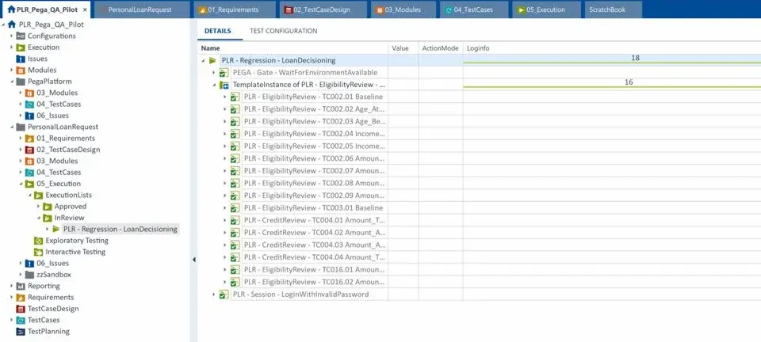

A request to migrate a test suite often sounds like a tool question: "Should we move from Tosca to Playwright?" It can also come the other way round, from a team whose code-first suite has nobody left to maintain it. The tool is rarely the first thing to settle. A migration changes who owns quality, what the team pays and which skills it hires for. The technology under test can end the discussion early.

Below are the questions I would put to such a team, in order. The facts about the tools were checked on the vendors' own pages in November 2026. My own experience comes from a lab: a fictional personal loan request application (PLR) that I built from a Pega Blueprint in a Pega Academy lab environment, on Pega Infinity '26.1 Constellation, tested with Tosca 26.1.2 (the [2026.1 LTS](https://docs.tricentis.com/tosca-2026.1/en-us/content/release_notes/key_features.htm) release line) and migrated to Playwright 1.65.0.

## What problem are we solving?

"Tosca is expensive" or "developers don't like Tosca" are symptoms. I ask for the concrete problem behind them:

- Feedback is too slow: tests run nightly on a separate agent, and a developer learns about a regression a day later.
- Ownership is split: testers maintain the suite, developers break it, and nobody fixes a red build quickly.
- The licence covers more seats than people who use them, or fewer than the team needs.
- The application has moved to a modern web front end, and the packaged-application coverage is no longer used.

If the real problem is suite design (duplicated steps, data tied to one environment, checks of business rules through the UI), a new tool will not fix it. A migration copies that design into the new tool, and fixing the suite in place may be cheaper. A migration earns its cost when the problem is structural: who writes the tests, where they run, what the team can sustain.

## Who owns the tests and the red build?

In my view this question carries the most weight, and it has three parts: who writes the tests, who maintains them in three years, and who fixes a red build.

Tricentis describes Tosca's strength plainly on its product page: "Codeless authoring removes the programming requirement" so that manual testers, business analysts and subject-matter experts can build automation alongside engineers ([Tricentis Tosca product page](https://www.tricentis.com/products/automate-continuous-testing-tosca), read 2026-11-17). That is a real advantage when the people who know the business process are not developers and will stay the main authors.
Playwright is a code-first framework. Its [languages page](https://playwright.dev/docs/languages) lists TypeScript, JavaScript, Python, Java and .NET. A well-built Playwright framework can reuse screens and flows much as Tosca reuses Modules (shared, reusable descriptions of the application's screens), but only if someone designs that layer. Without it, a code-first suite collects copied locators quickly. Code-first brings readable diffs, type checks and lint rules that catch empty tests, and it removes the low entry barrier for non-programmers.

*Tosca Commander with my PLR lab workspace. Own screenshot, cropped.*

Keep the tests in the application repository when you can. Developers then treat a red test as their problem and fix it in the pull request that broke it. When the tests live in a separate tool that only testers open, a red test tends to become a ticket. Playwright runs from the command line, so it fits a pipeline as an ordinary job ([Playwright docs](https://playwright.dev/docs/intro)).

Skills belong to the same question. A tool the team cannot staff is a risk, whatever its features. I expect Playwright skills to overlap with front-end development, while a test team that has built careers on Tosca loses that investment in a migration. So ask who will write the next hundred tests. If it is the developers, with a test engineer reviewing, code-first is the natural home. If it is the business testers, moving them to TypeScript is a training programme and needs a budget.

## What does it cost over five years?

I compare total cost of ownership, not licence prices alone. For Tosca that includes execution agents, their infrastructure and the specialists who maintain the workspace. I could not find a public price list on the Tricentis website, so use your own contract figures rather than numbers quoted on forums.

Playwright itself is free and open source under the Apache-2.0 licence ([microsoft/playwright on GitHub](https://github.com/microsoft/playwright), read 2026-11-17). That does not make it free to run. The costs move to people and pipelines: the framework layer, CI minutes or agents, browser updates and keeping up with releases. Playwright 1.65, for example, no longer tests on Node.js 20 ([Playwright release notes](https://playwright.dev/docs/release-notes), read 2026-11-17). Someone has to read the notes of every release.

A fair comparison also includes the migration itself and the period when both suites run side by side.

## What technology is under test?

This question can end the discussion early.

- Modern web front ends, including Pega Constellation: Playwright is a strong fit. In my PLR lab, the Constellation UI was automated with test ids derived from field labels and a shared Pega layer (sign-in, case view, tables) that every test reuses.
- Packaged enterprise applications such as SAP GUI, desktop clients and mixed end-to-end flows across several systems: this is where Tosca is built to be. Tricentis states that Tosca covers "200+ technologies" natively ([product page](https://www.tricentis.com/products/automate-continuous-testing-tosca)). As far as I know, Playwright drives browsers and does not drive SAP GUI or a thick client, so check that against your own systems.

Many estates are mixed. Then the honest answer is often both: Playwright for the web channels that developers own, Tosca for the packaged-application processes that business testers own.

## When should we not migrate?

A migration is the wrong choice, or part of the suite should stay in Tosca, when:

- the tests cover SAP GUI, desktop or other non-browser technology;
- the main authors are business testers who will stay, and nobody will maintain TypeScript;
- the suite is stable, fast enough and cheaper than the alternative over five years;
- the licence is committed for years and the team gains nothing before it ends;
- the reasons for moving are weak, such as a general dislike of the current tool.

The reverse migration, from code to Tosca, makes sense in the mirror case: a code-first suite that the developers left behind, business testers who must own it now, and packaged applications coming into scope.

## A short decision checklist

- [ ] The problem is written down and is structural (ownership, feedback speed, cost, skills), not only suite design.
- [ ] We know who will write and maintain tests in three years, and they can work in the target tool.
- [ ] We know who fixes a red build, and where the tests will live.
- [ ] The technology under test is browser-based, or the non-browser part stays in Tosca.
- [ ] We have a five-year cost comparison from our own contract figures, including the parallel run.

If most of these boxes stay empty, improving the suite you have is probably the better investment. If the answer is to migrate, the next question is how to show that each migrated test still checks what the old one did. That is the subject of the [second post](/blog/prove-a-migrated-test-is-as-strong).

## Sources

All read on 2026-11-17 unless a publication date is given.

- Playwright languages (read 2026-11-18): https://playwright.dev/docs/languages
- Playwright release notes (version 1.65, Node.js support): https://playwright.dev/docs/release-notes
- Playwright installation and system requirements: https://playwright.dev/docs/intro
- microsoft/playwright repository (Apache-2.0 licence): https://github.com/microsoft/playwright
- Tricentis Tosca product page (codeless authoring, technology coverage): https://www.tricentis.com/products/automate-continuous-testing-tosca
- Tosca 2026.1 LTS key features (release line): https://docs.tricentis.com/tosca-2026.1/en-us/content/release_notes/key_features.htm
