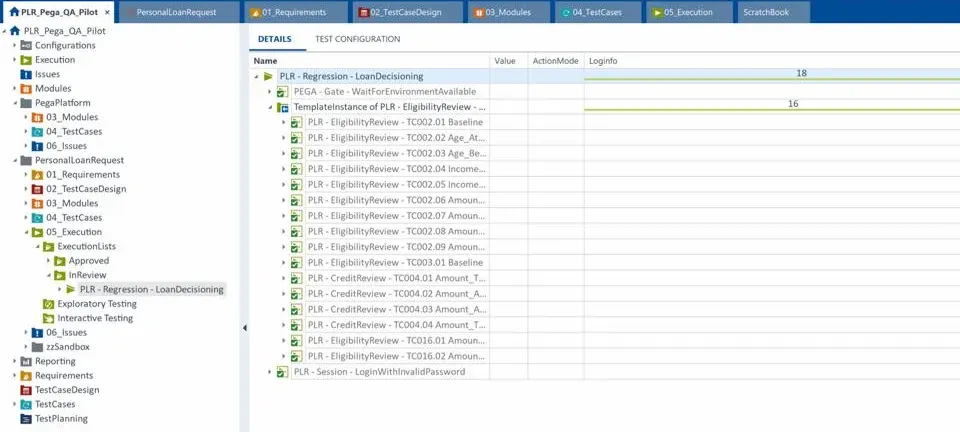

Een verzoek om een testsuite te migreren klinkt vaak als een toolvraag: “Moeten we van Tosca naar Playwright?” Het kan ook andersom komen, van een team met een code-first suite waar niemand meer voor kan zorgen. De tool is zelden het eerste wat beslist moet worden. Een migratie verandert wie de kwaliteit bezit, wat het team betaalt en op welke vaardigheden het werft. De technologie die getest wordt, kan de discussie vroeg beëindigen.

Hieronder staan de vragen die ik zo’n team in deze volgorde zou stellen. De feiten over de tools heb ik in november 2026 op de eigen pagina’s van de leveranciers gecontroleerd. Mijn eigen ervaring komt uit een lab: een fictieve applicatie voor persoonlijke leningaanvragen (PLR) die ik in een Pega Academy-labomgeving met een Pega Blueprint heb gebouwd. De applicatie draait op Pega Infinity '26.1 Constellation, is getest met Tosca 26.1.2 (de [2026.1 LTS](https://docs.tricentis.com/tosca-2026.1/en-us/content/release_notes/key_features.htm)-releaselijn) en gemigreerd naar Playwright 1.65.0.

![Beslisschema in vier stappen. Probleem: is het het ontwerp van de suite, dan kan de suite ter plekke verbeteren goedkoper zijn. Technologie, die de discussie vroeg kan beëindigen: browserapplicaties passen bij Playwright, SAP GUI en desktop blijven in Tosca, gemengde omgevingen gebruiken vaak allebei. Auteurs: schrijven ontwikkelaars de tests, dan is code-first het natuurlijke thuis; blijven business testers de auteurs, dan Tosca of een opleidingsbudget. Kosten: vijf jaar, inclusief de migratie en de parallelle periode.](decision-flow.webp)

## Welk probleem lossen we op?

“Tosca is duur” of “ontwikkelaars houden niet van Tosca” zijn symptomen. Ik vraag naar het concrete probleem erachter:

- De feedback is te traag: tests draaien ’s nachts op een aparte agent en een ontwikkelaar hoort een dag later van een regressie.
- Het eigenaarschap is gesplitst: testers onderhouden de suite, ontwikkelaars breken hem en niemand repareert een rode build snel.
- De licentie dekt meer plekken dan er gebruikers zijn, of minder dan het team nodig heeft.
- De applicatie is overgestapt op een moderne webfrontend en de dekking voor verpakte applicaties wordt niet meer gebruikt.

Als het echte probleem het ontwerp van de suite is (dubbele stappen, data die aan één omgeving vastzit, bedrijfsregels die via de UI worden gecontroleerd), lost een nieuwe tool dat niet op. Een migratie kopieert dat ontwerp naar de nieuwe tool en de suite ter plekke verbeteren kan goedkoper zijn. Een migratie verdient zich terug wanneer het probleem structureel is: wie de tests schrijft, waar ze draaien, wat het team kan volhouden.

## Wie is eigenaar van de tests en van de rode build?

Naar mijn mening weegt deze vraag het zwaarst, en ze heeft drie delen: wie schrijft de tests, wie onderhoudt ze over drie jaar en wie repareert een rode build.

Tricentis beschrijft de kracht van Tosca helder op de productpagina: “Codeless authoring removes the programming requirement”, zodat handmatige testers, business analisten en domeinexperts samen met engineers automatisering kunnen bouwen ([productpagina Tricentis Tosca](https://www.tricentis.com/products/automate-continuous-testing-tosca), gelezen op 2026-11-17). Dat is een echt voordeel wanneer de mensen die het bedrijfsproces kennen geen ontwikkelaars zijn en de belangrijkste auteurs blijven.
Playwright is een code-first framework. De [pagina over talen](https://playwright.dev/docs/languages) noemt TypeScript, JavaScript, Python, Java en .NET. Een goed gebouwd Playwright-framework kan schermen en flows hergebruiken, zoals Tosca Modules hergebruikt (gedeelde, herbruikbare beschrijvingen van de schermen van de applicatie), maar alleen als iemand die laag ontwerpt. Zonder die laag verzamelt een code-first suite snel gekopieerde locators. Code-first brengt leesbare diffs, typecontroles en lintregels die lege tests vangen, en neemt de lage instapdrempel voor niet-programmeurs weg.

*Tosca Commander met mijn PLR-labwerkruimte. Eigen screenshot, bijgesneden.*

Houd de tests waar mogelijk in de repository van de applicatie. Ontwikkelaars zien een rode test dan als hun eigen probleem en repareren hem in de pull request die hem brak. Wanneer de tests in een aparte tool staan die alleen testers openen, wordt een rode test vaak een ticket. Playwright draait vanaf de commandoregel en past daardoor als gewone job in een pipeline ([Playwright-documentatie](https://playwright.dev/docs/intro)).

Vaardigheden horen bij dezelfde vraag. Een tool die het team niet kan bemensen is een risico, wat de functies ook zijn. Ik verwacht dat Playwright-vaardigheden overlappen met frontend-ontwikkeling, terwijl een testteam dat zijn loopbaan op Tosca heeft gebouwd die investering bij een migratie verliest. Vraag dus wie de volgende honderd tests schrijft. Zijn dat de ontwikkelaars, met een testengineer als reviewer, dan is code-first het natuurlijke thuis. Zijn het de business testers, dan is hen naar TypeScript brengen een opleidingstraject en heeft het budget nodig.

## Wat kost het over vijf jaar?

Ik vergelijk de total cost of ownership, niet alleen licentieprijzen. Voor Tosca horen daar execution agents bij, hun infrastructuur en de specialisten die de workspace onderhouden. Ik kon op de website van Tricentis geen openbare prijslijst vinden, dus gebruik de cijfers uit je eigen contract in plaats van bedragen van fora.

Playwright zelf is gratis en open source onder de Apache-2.0-licentie ([microsoft/playwright op GitHub](https://github.com/microsoft/playwright), gelezen op 2026-11-17). Dat maakt het niet gratis om te draaien. De kosten verschuiven naar mensen en pipelines: de frameworklaag, CI-minuten of agents, browserupdates en het bijhouden van releases. Playwright 1.65 test bijvoorbeeld niet meer op Node.js 20 ([release notes van Playwright](https://playwright.dev/docs/release-notes), gelezen op 2026-11-17). Iemand moet de notes van elke release lezen.

Een eerlijke vergelijking omvat ook de migratie zelf en de periode waarin beide suites naast elkaar draaien.

## Welke technologie wordt getest?

Deze vraag kan de discussie vroeg beëindigen.

- Moderne webfrontends, waaronder Pega Constellation: Playwright past goed. In mijn PLR-lab werd de Constellation-UI geautomatiseerd met test-ids afgeleid van veldlabels en een gedeelde Pega-laag (inloggen, caseweergave, tabellen) die elke test hergebruikt.
- Verpakte bedrijfsapplicaties zoals SAP GUI, desktopclients en gemengde end-to-end-flows over meerdere systemen: hier is Tosca voor gebouwd. Tricentis stelt dat Tosca “200+ technologies” standaard dekt ([productpagina](https://www.tricentis.com/products/automate-continuous-testing-tosca)). Voor zover ik weet stuurt Playwright browsers aan en geen SAP GUI of dikke client, dus controleer dat tegen je eigen systemen.

Veel omgevingen zijn gemengd. Dan is het eerlijke antwoord vaak allebei: Playwright voor de webkanalen die ontwikkelaars bezitten, Tosca voor de processen op verpakte applicaties die business testers bezitten.

## Wanneer migreren we niet?

Een migratie is de verkeerde keuze, of een deel van de suite moet in Tosca blijven, wanneer:

- de tests SAP GUI, desktop of andere technologie buiten de browser dekken;
- de belangrijkste auteurs business testers zijn die blijven en niemand TypeScript gaat onderhouden;
- de suite stabiel is, snel genoeg en over vijf jaar goedkoper dan het alternatief;
- de licentie voor jaren vastligt en het team er voor het einde niets mee wint;
- de redenen om over te stappen zwak zijn, zoals een algemene afkeer van de huidige tool.

De omgekeerde migratie, van code naar Tosca, is zinvol in het spiegelbeeld: een code-first suite die de ontwikkelaars hebben achtergelaten, business testers die hem nu moeten beheren en verpakte applicaties die in scope komen.

## Een korte checklist voor de beslissing

- [ ] Het probleem is opgeschreven en structureel (eigenaarschap, feedbacksnelheid, kosten, vaardigheden), niet alleen het ontwerp van de suite.
- [ ] We weten wie de tests over drie jaar schrijft en onderhoudt, en zij kunnen in de doeltool werken.
- [ ] We weten wie een rode build repareert en waar de tests komen te staan.
- [ ] De geteste technologie draait in de browser, of het deel buiten de browser blijft in Tosca.
- [ ] We hebben een vijfjarige kostenvergelijking op basis van onze eigen contractcijfers, inclusief de parallelle run.

Blijven de meeste van deze vakjes leeg, dan is het verbeteren van de suite die je hebt waarschijnlijk de betere investering. Is het antwoord migreren, dan is de volgende vraag hoe je aantoont dat elke gemigreerde test nog steeds controleert wat de oude controleerde. Dat is het onderwerp van de [tweede post](/nl/blog/prove-a-migrated-test-is-as-strong).

## Bronnen

Allemaal gelezen op 2026-11-17, tenzij een publicatiedatum is genoemd.

- Playwright-talen (gelezen op 2026-11-18): https://playwright.dev/docs/languages
- Playwright release notes (versie 1.65, Node.js-ondersteuning): https://playwright.dev/docs/release-notes
- Playwright-installatie en systeemvereisten: https://playwright.dev/docs/intro
- microsoft/playwright-repository (Apache-2.0-licentie): https://github.com/microsoft/playwright
- Productpagina Tricentis Tosca (codeless authoring, technologiedekking): https://www.tricentis.com/products/automate-continuous-testing-tosca
- Tosca 2026.1 LTS key features (releaselijn): https://docs.tricentis.com/tosca-2026.1/en-us/content/release_notes/key_features.htm
